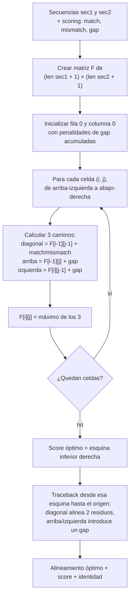

# TP: Alineamientos y búsqueda de similitud secuencial

Resolución del TP [Alineamientos y Búsqueda de similitud secuencial](https://github.com/AJVelezRueda/Introduccion_a_la_Bioinformatica/blob/master/Teorico_Practicos/Bioinform%C3%A1tica_Primeros_pasos/Alineamientos_secuenciales.md) (Dra. Ana Julia Velez Rueda).

Es un TP mayormente conceptual: se trabaja con tres herramientas interactivas
(la [tabla UMI](https://flbulgarelli.github.io/umi/), el
[alineador de Freiburg](http://rna.informatik.uni-freiburg.de/Teaching/index.jsp?toolName=Needleman-Wunsch)
y [BLAST del NCBI](https://blast.ncbi.nlm.nih.gov/Blast.cgi)). Para llevar los
Desafíos V y VI "a lo concreto" se agrega una implementación propia de
**Needleman-Wunsch**.

## Estructura

| Archivo | Qué resuelve |
|---|---|
| `needleman_wunsch.py` | Desafíos V y VI: alineamiento global por programación dinámica |
| `datos/desafio_vii_query.fasta` | Secuencia problema del Desafío VII |
| `datos/desafio_ix_query.fasta` | Secuencia problema del Desafío IX |
| `tests/` | Tests con pytest |

Todos los comandos se corren **desde esta carpeta** (`cd alineamientos_secuenciales`).

> 📝 Los Desafíos IX y X (identificación por BLAST) están resueltos con la
> corrida real. Los Desafíos I–IV, VI, VII y VIII piden *tomar nota de tus
> propias observaciones* con las herramientas interactivas (la tabla UMI y los
> gráficos de BLAST): abajo está la teoría y qué mirar en cada caso, y donde
> dice **✍️ Tus observaciones** reemplazá por lo que veas vos (sumá capturas).

---

## 🤔 Para pensar: ¿qué información se extrae de comparar secuencias?

Comparar dos secuencias (de ADN, ARN o proteína) permite estimar si son
**homólogas**, es decir si comparten un ancestro común. De ahí se infiere:

- **Relación evolutiva**: qué tan emparentadas están y, con varias secuencias, reconstruir filogenias.
- **Función**: si una proteína nueva se parece a una ya caracterizada, es una fuerte pista de que cumple una función parecida.
- **Regiones conservadas**: las posiciones que no cambiaron suelen ser importantes (sitio activo, motivos estructurales); las variables toleran mutaciones.
- **Tipo de cambios**: sustituciones (mutaciones puntuales) vs. inserciones/deleciones (gaps).

Esperaría ver una comparación **posición a posición**: columnas donde los
residuos coinciden (conservación) y columnas con cambios o huecos. No es tan
simple como superponer una secuencia sobre otra, porque a lo largo del tiempo
hubo inserciones y deleciones que corren el marco de la comparación.

## 🤔 Para pensar: ¿por qué conviene comparar proteínas para relaciones lejanas?

Por dos motivos principales:

1. **El código genético es degenerado.** Varios codones codifican el mismo aminoácido (sobre todo en la 3.ª posición), así que el ADN acumula muchas mutaciones *sinónimas* que no cambian la proteína. En relaciones lejanas el ADN "satura" de cambios silenciosos y pierde señal; la proteína retiene mejor la información evolutiva.
2. **Alfabeto más grande y con significado bioquímico.** Las proteínas usan 20 aminoácidos (vs. 4 nucleótidos), por lo que la probabilidad de coincidir *por azar* es mucho menor (~5% vs. ~25%). Además, con matrices de sustitución se puede ponderar que un cambio entre aminoácidos parecidos (p. ej. Leu↔Ile) "cuesta" menos que uno drástico.

Para relaciones **cercanas** conviene el ADN: es más variable y permite
distinguir organismos muy parecidos, que a nivel proteico serían idénticos.

---

## 🧗 Desafío I: alinear "BANANA" y "MANZANA"

Lo primero que se ve es que **no hay una única forma de alinearlas**. Se puede
abrir el gap en distintos lugares; el que maximiza coincidencias es:

```
BAN-ANA
 || |||
MANZANA
```

☑️ **Preguntas disparadoras**
- **¿Existe una única forma?** No. Hay muchas combinaciones posibles según dónde se inserten los gaps.
- **¿Alguno es mejor?** Sí: el que maximiza residuos alineados coincidentes y minimiza gaps/mismatches. Alineando el gap frente a la **Z** (que BANANA no tiene) quedan 5 de 6 letras alineadas. Es "mejor" porque requiere menos eventos evolutivos (inserciones/mutaciones) para pasar de una palabra a la otra: es el principio de **parsimonia**.

> **Observaciones (jugadas):** probando en la tabla, alinear el gap frente a la **Z** deja 5/6 letras alineadas (`BAN-ANA` / `MANZANA`); cualquier otro lugar para el gap genera más mismatches. Reproducido con el script: `python needleman_wunsch.py BANANA MANZANA` → **score 2, identidad 83.3%**. Conclusión: aunque hay muchos alineamientos posibles, el que minimiza cambios (parsimonia) es único y es el que elige el algoritmo.

## 🧗 Desafío II: identidad de "ANA" vs "ANANA"

La **identidad** es la suma de residuos idénticos en posiciones equivalentes de
dos secuencias alineadas. El problema es que **el valor depende del denominador
que uses**, y hay más de una convención:

- idénticos / largo de la secuencia más corta
- idénticos / largo de la secuencia más larga
- idénticos / largo del alineamiento (contando o no las columnas con gap)

Por eso distintos alineamientos (y distintas fórmulas) dan **valores de
identidad distintos** para el mismo par de palabras.

☑️ **Preguntas disparadoras**
- **¿Son todos los valores iguales?** No, cambian según el alineamiento y según cómo se calcule.
- **¿Qué considerar?** Hay que fijar y aclarar el denominador, y decidir qué se hace con las columnas que tienen gap.
- **¿Distintas formas de calcularlo? ¿Todas válidas en Biología?** Matemáticamente todas son válidas, pero no dan lo mismo ni comunican lo mismo. En Biología importa **sobre qué longitud** se calcula: un 90% de identidad sobre 300 residuos es mucho más informativo que un 90% sobre 10. Por eso la identidad siempre se reporta junto con la **cobertura** y la **significancia** (ver E-value, Desafío VII).

**Observaciones (jugadas):** probé varios alineamientos de ANA/ANANA y calculé la
identidad de dos formas: sobre las columnas sin gap y sobre el largo total del
alineamiento (5 columnas).

| Alineamiento | id (columnas sin gap) | id (sobre largo del aln) |
|---|---|---|
| `--ANA` / `ANANA` | 100.0% | 60.0% |
| `ANA--` / `ANANA` | 100.0% | 60.0% |
| `AN--A` / `ANANA` | 100.0% | 60.0% |
| `A-N-A` / `ANANA` | 66.7% | 40.0% |

El mismo par de palabras da identidades **distintas** según el alineamiento y
según el denominador elegido. Conclusión: la identidad sola no alcanza; hay que
aclarar siempre sobre qué longitud se calcula y qué se hace con los gaps.

> El script calcula la identidad ignorando las columnas con gap (ver `identidad()` en `needleman_wunsch.py`).

## 🧗 Desafío III: penalidad de gaps

Al subir la penalidad del gap, los alineamientos con muchos huecos pierden
score y dejan de ser elegidos: el algoritmo prefiere alinear residuos (aunque
sean mismatches) antes que abrir gaps.

☑️ **Preguntas disparadoras**
- **Relación identidad ↔ penalidad:** con gaps "baratos" aparecen alineamientos con muchos huecos pero alta identidad en las columnas que quedan; con gaps "caros" se evitan los huecos y puede bajar la identidad aparente.
- **¿Qué implica penalizar más los gaps?** Asumir que las inserciones/deleciones son evolutivamente raras o costosas. Castiga de más a secuencias que sí difieren en longitud.
- **Otra forma de penalización:** la penalidad **afín** (la que usan de verdad las herramientas): un costo alto por *abrir* un gap y uno bajo por *extenderlo*. Biológicamente tiene sentido: es más probable un solo evento que inserta/borra un bloque de N residuos que N eventos independientes de 1 residuo.

**Observaciones (jugadas):** variando la penalidad del gap para ANA/ANANA (match +1, mismatch −1):

| gap | alineamiento óptimo | score | identidad |
|---|---|---|---|
| −1 | `--ANA` / `ANANA` | +1 | 100.0% |
| −2 | `--ANA` / `ANANA` | −1 | 100.0% |
| −4 | `--ANA` / `ANANA` | −5 | 100.0% |

Como las dos palabras solo difieren en longitud, el alineamiento óptimo no cambia
(sigue conviniendo abrir gaps), pero el **score se desploma** al encarecer el gap.
En pares que *sí* difieren en residuos, una penalidad alta hace que el algoritmo
prefiera un mismatch antes que abrir un hueco. Conclusión: penalizar mucho los gaps
equivale a asumir que las inserciones/deleciones son evolutivamente raras; una
penalización más realista es la **afín** (abrir caro, extender barato).

> Probado con `python needleman_wunsch.py ANA ANANA --gap -1` / `--gap -4`.

## 🤔 Para pensar: gaps en alineamientos de ácidos nucleicos

El código genético se lee de a **tripletes (codones)**. Un indel que **no sea
múltiplo de 3** corre el marco de lectura (*frameshift*) de ahí en adelante y
cambia todos los aminoácidos río abajo: suele ser mucho más dañino. Un indel de
3 (o múltiplo de 3) agrega/quita aminoácidos enteros sin romper el marco.

## 🧗 Desafío IV: nucleótidos, codones y traducción

Al alinear secuencias nucleotídicas y mirar su traducción se ve que **la
posición del gap dentro del codón importa**:

- **No da lo mismo** si el gap cae en la 1.ª, 2.ª o 3.ª posición: aun un gap de 1 produce un frameshift que altera la proteína entera a partir de ahí.
- Para ponderar el parecido de secuencias **codificantes** conviene penalizar más los indels que rompen el marco (los que no son múltiplo de 3), o directamente alinear a nivel de **proteína** y recién después proyectar el alineamiento sobre los codones (*codon-aware alignment*).

**Observaciones (jugadas):** partiendo de `ATGAAACCCGGG` (→ **M-K-P-G**):

| Cambio | Secuencia | Traducción | Efecto |
|---|---|---|---|
| referencia | `ATGAAACCCGGG` | M-K-P-G | — |
| gap de 1 (no múltiplo de 3) | `ATG-AACCCGGG` | M-N-P… | **frameshift**: cambian todos los codones río abajo |
| gap de 3 (múltiplo de 3) | `ATG---CCCGGG` | M-P-G | se pierde **un** aminoácido (K), el resto queda intacto |

Conclusión: en secuencias codificantes un indel que no es múltiplo de 3 es
mucho más dañino que uno que sí lo es; por eso conviene ponderar los gaps según
su efecto sobre el marco de lectura (o alinear directamente las proteínas).

---

## 🧗 Desafío V: pasos de un alineamiento con matriz de scoring

Pasos para alinear dos secuencias cortas con una matriz de scoring que penaliza
distinto match, mismatch y gap (implementado en `needleman_wunsch.py`):



En código, el corazón del algoritmo es el paso E–F:

```python
puntaje   = match if sec1[i-1] == sec2[j-1] else mismatch
diagonal  = F[i-1][j-1] + puntaje
arriba    = F[i-1][j]   + gap
izquierda = F[i][j-1]   + gap
F[i][j]   = max(diagonal, arriba, izquierda)
```

```bash
python needleman_wunsch.py BANANA MANZANA --matriz
python needleman_wunsch.py GATTACA GCATGCU --match 1 --mismatch -1 --gap -2
```

## 🤔 Para pensar: ¿qué es la programación dinámica y por qué sirve acá?

La **programación dinámica** resuelve un problema grande dividiéndolo en
subproblemas más chicos, resolviendo cada uno **una sola vez** y guardando su
resultado para reutilizarlo. Sirve para alinear porque el mejor alineamiento de
dos prefijos `sec1[:i]` y `sec2[:j]` se construye a partir del mejor
alineamiento de prefijos más cortos (los vecinos de arriba, izquierda y
diagonal). La cantidad de alineamientos posibles crece de forma **exponencial**,
pero la matriz tiene solo `(n+1)×(m+1)` celdas: pasamos de un costo exponencial
a uno **cuadrático**, y encima garantiza encontrar el óptimo (no es una
heurística).

## 🧗 Desafío VI: Needleman-Wunsch y de dónde salen los valores de la matriz

Cada valor `F[i][j]` es el **mejor score acumulado** para alinear los primeros
`i` residuos de sec1 con los primeros `j` de sec2. Sale del máximo de tres
decisiones, cada una apoyada en una celda ya calculada:

| Camino | Viene de | Representa |
|---|---|---|
| Diagonal `↘` | `F[i-1][j-1] + match/mismatch` | alinear `sec1[i]` con `sec2[j]` |
| Arriba `↓` | `F[i-1][j] + gap` | gap en la secuencia horizontal (sec2) |
| Izquierda `→` | `F[i][j-1] + gap` | gap en la secuencia vertical (sec1) |

La primera fila y columna son gaps acumulados (alinear contra "nada" cuesta un
gap por residuo). El **traceback** recorre la matriz al revés desde la esquina
inferior derecha: cada diagonal alinea dos residuos, cada paso vertical/horizontal
introduce un gap. Ese camino de máximo score **es** el alineamiento óptimo.

Ejemplo (`python needleman_wunsch.py BANANA MANZANA --matriz`, con match=+1, mismatch=−1, gap=−2):

```
           M   A   N   Z   A   N   A
       0  -2  -4  -6  -8 -10 -12 -14
   B  -2  -1  -3  -5  -7  -9 -11 -13
   A  -4  -3   0  -2  -4  -6  -8 -10
   N  -6  -5  -2   1  -1  -3  -5  -7
   A  -8  -7  -4  -1   0   0  -2  -4
   N -10  -9  -6  -3  -2  -1   1  -1
   A -12 -11  -8  -5  -4  -1  -1   2
```

El score óptimo (abajo a la derecha) es **2**, y el traceback reconstruye
`BAN-ANA / MANZANA`.

**Observaciones (jugadas):** con el
[alineador de Freiburg](http://rna.informatik.uni-freiburg.de/Teaching/index.jsp?toolName=Needleman-Wunsch)
y con el script se ve que el *gap penalty* **cambia el camino óptimo**, no solo
el score. Ejemplo `GATTACA` vs `GCATGCU`:

| gap | alineamiento óptimo | score | identidad |
|---|---|---|---|
| −1 (gaps baratos) | `G-ATTACA` / `GCA-TGCU` | 0 | 66.7% |
| −3 (gaps caros) | `GATTACA` / `GCATGCU` | −1 | 42.9% |

Con gaps baratos conviene **abrir dos huecos** para maximizar coincidencias; con
gaps caros el algoritmo los **evita** y tolera mismatches. Es exactamente lo que
muestra la matriz de Freiburg: al subir la penalidad, el retroceso deja de pasar
por celdas verticales/horizontales. Reproducible con
`python needleman_wunsch.py GATTACA GCATGCU --gap -1 --matriz` vs `--gap -3`.

## 🤔 Para pensar: ¿cuándo usar alineamiento global/local y de a pares/múltiple?

- **Global** (Needleman-Wunsch): cuando las secuencias son de **tamaño y composición parecidos** y se espera que alineen de punta a punta (p. ej. dos ortólogos de un gen conservado). Limitación: fuerza a alinear los extremos aunque no correspondan.
- **Local** (Smith-Waterman, BLAST): cuando interesa una **región** común entre secuencias de distinto tamaño o con zonas no conservadas (p. ej. un dominio dentro de una proteína grande). Limitación: puede ignorar el contexto global.
- **De a pares:** mide similitud entre **dos** secuencias; simple y exacto.
- **Múltiple** (MSA): compara **más de dos** a la vez, revela columnas conservadas, motivos y sirve de base para filogenias y perfiles. Limitación: es computacionalmente caro (se resuelve con heurísticas progresivas, tipo Clustal/MUSCLE/MAFFT) y la calidad depende del orden en que se agregan las secuencias.

---

## 🧗 Desafío VII: BLAST — E-value, score e identidad

> 🔗 Secuencia en `datos/desafio_vii_query.fasta`. Es un fragmento de la
> **proteína priónica (PrP)** — se reconoce al mirar los primeros hits.

**Cómo correrlo:** `blastp` en [NCBI](https://blast.ncbi.nlm.nih.gov/Blast.cgi) →
pegar la secuencia → en *Algorithm parameters* poner **Max target sequences =
20000** y **Expect threshold = 100** → correr → filtrar los hits con
**≥ 70% de cobertura** (columna *Query Cover*). Descargar la tabla de hits
(botón *Download → Hit Table/CSV*) para graficar.

**Qué mirar en los gráficos:**

- **E-value vs % identidad:** relación **inversa**. A mayor identidad, menor E-value (más significativo). El E-value es la cantidad de hits con ese score que esperaríamos **por azar** en una base de ese tamaño: cuanto más chico, más confiable. Ojo: el E-value depende del tamaño de la base de datos y del largo del query, no solo de la identidad.
- **Score vs % identidad:** relación **directa** (más identidad → más score), pero **no perfecta**: un hit corto muy idéntico puede tener menos score que uno largo algo menos idéntico, porque el score es *acumulativo* (suma a lo largo del alineamiento).
- **Score vs E-value:** relación **inversa** y aproximadamente exponencial: `E ∝ e^(−λ·score)`. Scores altos → E-values que caen muy rápido hacia 0.

> ✍️ **Tus resultados:** _(pegá acá tus gráficos/tabla y la conclusión. Recordá que el E-value no es una probabilidad y que una significancia estadística no garantiza homología real.)_

## 🧗 Desafío VIII: fragmentos de la secuencia problema

Repetir el BLAST con la **mitad** y un **cuarto** de la secuencia del Desafío VII.

**Qué se espera:** al acortar el query,

- caen el **score** y la **cobertura** (hay menos secuencia para alinear);
- **suben los E-values** (un alineamiento corto es más fácil de encontrar por azar → menos significativo);
- aparecen **más hits espurios** y se pueden perder homólogos lejanos verdaderos.

**Conclusión:** la significancia estadística depende del **largo** del query, no
solo del % de identidad. Secuencias muy cortas dan resultados poco confiables
aunque la identidad sea alta; por eso BLAST avisa cuando el query es corto y
ajusta parámetros (word size, matriz).

> ✍️ **Tus resultados:** _(compará los gráficos de secuencia completa / mitad / cuarto)_

## 🧗 Desafío IX: identificar la proteína problema

> 🔗 Secuencia en `datos/desafio_ix_query.fasta`. Se corrió **blastp** contra la
> base **nr** (non-redundant protein).

Por su patrón de **repeticiones de hexapéptidos** (`[LIV]-G-x-x-x-x` que se
repite a lo largo de la secuencia: `...VEIGEG...KIGRDN...RVEIGDRN...KVGSDN...TVGNRC...`),
la secuencia ya anticipaba la firma de la **superfamilia de aciltransferasas de
hexapéptido**, de plegamiento **β-hélice levógira (LβH)**. BLAST lo confirma:

| Mejor hit | Descripción | Score | E-value | Identidad |
|---|---|---|---|---|
| `WP_000565966.1` (= `NP_414723.1` en *E. coli* K-12) | acyl-ACP--UDP-N-acetylglucosamine O-acyltransferase (**LpxA**) | 533 bits | 0.0 | 100% |

La proteína es la **LpxA** (*acil-[ACP]--UDP-N-acetilglucosamina
O-aciltransferasa*, EC 2.3.1.129).

> **Para pensar** 🤔:
> - **Función:** cataliza el **primer paso de la biosíntesis del lípido A** (el ancla hidrofóbica del lipopolisacárido / endotoxina de la membrana externa de bacterias Gram-negativas). Transfiere un grupo acilo desde una ACP a la UDP-GlcNAc. Su plegamiento LβH es justo el que anticipaban las repeticiones de hexapéptidos.
> - **Grupo taxonómico:** **bacterias Gram-negativas** (Pseudomonadota/Proteobacteria). El mejor hit con nombre de especie es *Escherichia coli* (K-12 MG1655, `NP_414723.1`), y aparece como "MULTISPECIES" porque es idéntica en muchas enterobacterias.
> - **¿Cuántas secuencias similares a significancia adecuada?** Muchísimas: **todos** los primeros hits tienen **100% de identidad y E-value 0.0**, y hay miles de homólogos bacterianos con E-values ínfimos. Es una enzima esencial y muy conservada.

## 🧗 Desafío X: BLASTp contra la base PDB

Misma secuencia del Desafío IX, pero eligiendo la base de datos **PDB** (en vez
de nr).

**Qué se obtiene:**

- **No** son los mismos resultados que contra nr: PDB es mucho más chica (solo secuencias con **estructura 3D resuelta** por cristalografía/crio-EM/RMN), así que hay **muchos menos hits**. Para esta proteína se recuperan las estructuras cristalográficas de la propia **LpxA**, por ejemplo `2JF2_A` y `7OKC_A` (*Chain A, acyl-[ACP]--UDP-N-acetylglucosamine O-acyltransferase*), con **100% de identidad y score 533 bits** (aparecen incluso en la corrida contra nr).
- Cada hit trae un **código PDB** (ej. `2JF2`) → se puede abrir la estructura real en el visor del NCBI o en [RCSB PDB](https://www.rcsb.org/).
- **¿Cuándo es útil?** Cuando además de identificar querés **modelar la estructura** de tu proteína: buscás el pariente con estructura conocida más cercano para usarlo como molde (*homology modeling*) o para ubicar el sitio activo / entender el plegamiento. BLAST contra PDB es el primer paso del modelado por homología.

## 🤔 Para pensar: los programas de la familia BLAST

| Programa | Query | Base | Para qué |
|---|---|---|---|
| **blastn** | nucleótidos | nucleótidos | comparar ADN/ARN (relaciones cercanas, identificar especies) |
| **blastp** | proteína | proteína | comparar proteínas (Desafíos VII–X) |
| **blastx** | nucleótidos (traducidos en 6 marcos) | proteína | anotar un ADN/transcripto desconocido buscando qué proteína codifica |
| **tblastn** | proteína | nucleótidos (traducidos) | buscar una proteína en genomas/ESTs no anotados |
| **tblastx** | nucleótidos (traducidos) | nucleótidos (traducidos) | comparar regiones codificantes entre dos ADN, a nivel proteico |

Regla práctica: siempre que se pueda, comparar **a nivel de proteína** (más
sensible para relaciones lejanas; ver la 2.ª *Para pensar*).

---

## Tests

```bash
python -m pytest tests -v
```
