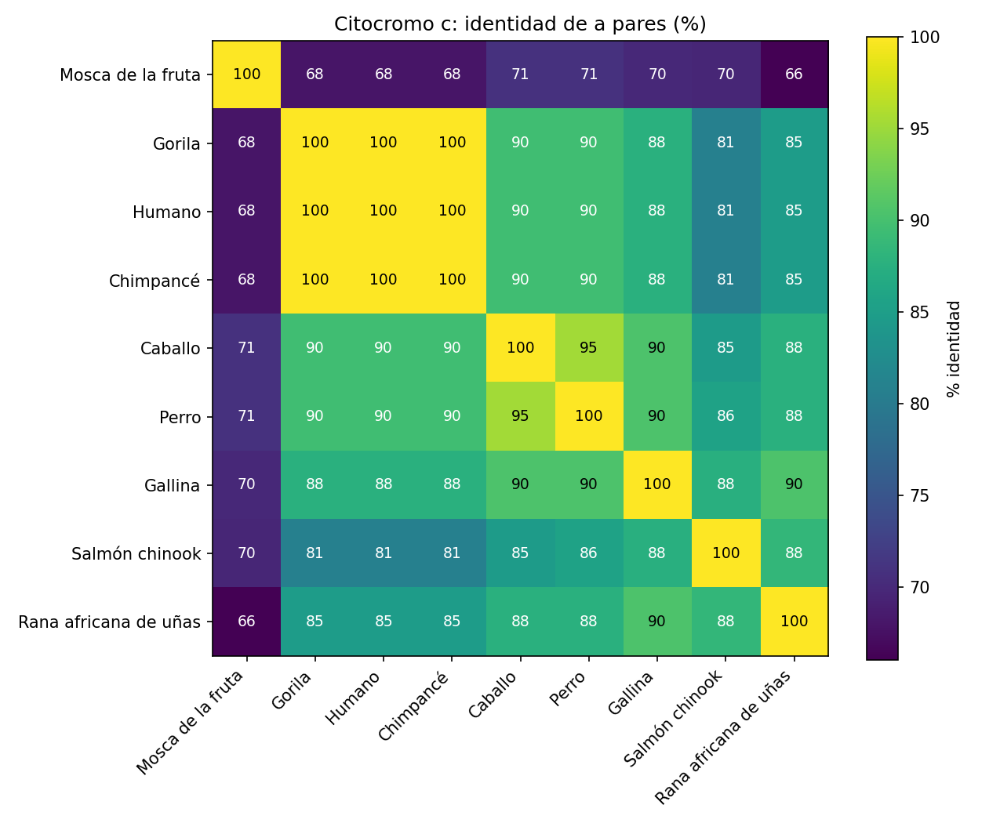
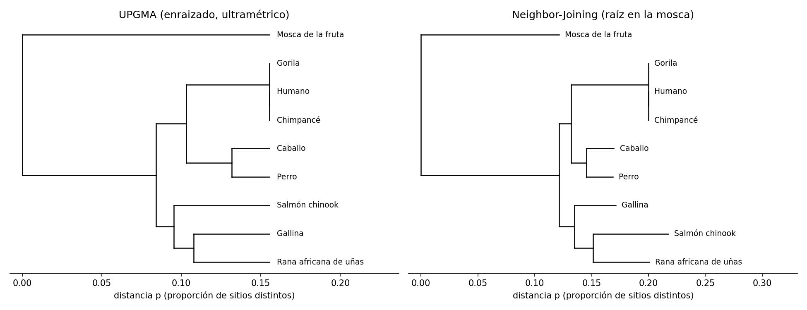

# TP: ¿En qué se parecen una gallina y una mosca?

Resolución del TP [¿En qué se parecen una gallina y una mosca?](https://github.com/AJVelezRueda/Introduccion_a_la_Bioinformatica/blob/master/Teorico_Practicos/Bioinform%C3%A1tica_Primeros_pasos/En_que_se_parece_una_mosca_y_una_gallina.md) (Dra. Ana Julia Velez Rueda).

Se comparan los citocromos c de nueve organismos: se bajan las secuencias de
NCBI Protein, se alinean y se analiza el alineamiento (identidad, columnas
conservadas, árbol). Además de usar las herramientas web, el análisis se
reproduce con un script propio que calcula la identidad de a pares, recalcula
la línea de conservación de Clustal y arma dos árboles de distancias (UPGMA y
Neighbor-Joining) implementados a mano.

## Estructura

| Archivo | Qué resuelve |
|---|---|
| `descargar_datos.py` | Baja las 9 secuencias de NCBI (efetch) y, opcionalmente, corre Clustal Omega en el EBI |
| `analisis_citocromo_c.py` | Identidad de a pares, diferencias humano/gallina, línea `* : .`, árboles UPGMA y NJ, figuras |
| `datos/citocromo_c.fasta` | Las 9 secuencias tal como las devuelve NCBI |
| `datos/citocromo_c_mafft.aln` / `.fasta` | Alineamiento múltiple (formato Clustal y FASTA) |
| `resultados/heatmap_identidad.png` | Matriz de identidad de a pares |
| `resultados/arboles.png` | Árboles UPGMA y NJ |
| `tests/` | Tests con pytest |

Todos los comandos se corren **desde esta carpeta** (`cd citocromo_c`).

```bash
python descargar_datos.py              # baja las secuencias (necesita internet)
python analisis_citocromo_c.py         # análisis + figuras (offline)
```

> 📝 **Sobre el alineamiento.** El servicio de Clustal Omega del EBI rechazó los
> envíos por API durante la resolución ("temporarily blocked from submitting new
> sequence analysis jobs", su política de *fair use*). Para no frenar el TP
> alineé las mismas 9 secuencias con **MAFFT v7.526 (L-INS-i)** en local, que
> devuelve el resultado en el mismo formato Clustal, con la línea `* : .`
> incluida. El citocromo c está tan conservado que el alineamiento casi no tiene
> decisiones que tomar (solo 5 de 107 columnas tienen gaps). Para reproducirlo
> en la herramienta oficial: entrar a
> [Clustal Omega](https://www.ebi.ac.uk/jdispatcher/msa/clustalo), pegar
> `datos/citocromo_c.fasta`, *Submit*, y en el resultado usar *Show Colors* y la
> pestaña *Phylogenetic Tree*. También se puede hacer con
> `python descargar_datos.py --clustalo`, que guarda el `.aln` y los árboles del
> servidor en `datos/`. El script de análisis acepta cualquiera de los dos
> alineamientos: `python analisis_citocromo_c.py --aln datos/citocromo_c_clustalo.aln`.

---

## Tabla de organismos

| Secuencia | Nombre taxonómico | Nombre común |
|---|---|---|
| `NP_061820.1` | *Homo sapiens* | Humano |
| `NP_001072946.1` | *Gallus gallus* | Gallina (pollo doméstico) |
| `NP_001065289.1` | *Pan troglodytes* | Chimpancé |
| `NP_001157486.1` | *Equus caballus* | Caballo |
| `NP_001183974.1` | *Canis lupus familiaris* | Perro |
| `AEP27192.1` | *Gorilla gorilla* | Gorila occidental |
| `XP_024245566.1` | *Oncorhynchus tshawytscha* | Salmón chinook (salmón real) |
| `NP_001086101.1` | *Xenopus laevis* | Rana africana de uñas |
| `NP_477164.1` | *Drosophila melanogaster* | Mosca de la fruta |

Dos detalles que aparecen al bajar los FASTA y que conviene tener en cuenta
después: la entrada de *Xenopus* está anotada como **"cytochrome c,
testis-specific"** y la de *Drosophila* como **"cytochrome c distal, isoform A"**
(la mosca tiene dos genes de citocromo c, *distal* y *proximal*). Es decir, no
son necesariamente la versión "principal" de la proteína en esos organismos.

La secuencia humana de NCBI tiene **105** residuos: son los 104 que menciona el
enunciado más la metionina inicial, que se quita en la proteína madura. En
este README las posiciones se cuentan **sobre la secuencia de NCBI**, con la
Met como posición 1 (para pasar a la numeración clásica de la proteína madura
hay que restar 1).

---

## 🤔 Para pensar: ¿cuán sencillo es alinear a mano?

Depende de tres cosas:

- **Número de secuencias.** Con dos es manejable; con nueve hay que mantener
  coherentes todas las columnas a la vez, y cada gap que se agrega en una
  secuencia afecta su relación con todas las demás. El costo de buscar el
  alineamiento óptimo crece de forma exponencial con la cantidad de secuencias,
  por eso los programas usan heurísticas (alineamiento progresivo guiado por un
  árbol).
- **Longitud.** Más residuos, más lugares posibles para abrir gaps y más
  chances de equivocarse.
- **Similitud.** Es lo que más pesa. Si las secuencias son muy parecidas el
  alineamiento "sale solo"; si son lejanas hay que decidir dónde van los
  indels y hay muchas soluciones que parecen igual de buenas.

**Observaciones:** humano y gallina se alinean a mano sin problema: miden lo
mismo (105) y no necesitan **ningún** gap; se ponen una debajo de la otra y se
comparan. La mosca ya complica: tiene dos residuos extra al principio
(`MGSG...` contra `MGD...`) y le faltan al final, así que hay que decidir dónde
correrla. Con las 9 secuencias el alineamiento tiene 107 columnas y 5 de ellas
llevan gaps.

## 🤔 Para pensar: ¿son parecidos los citocromos c de humano y gallo?

Sí, muy parecidos: **92 de 105 posiciones son idénticas (87,6 % de
identidad)** y no hay ningún gap. Las 13 diferencias son:

| Posición | Humano | Gallina | Tipo de cambio (criterio de Clustal) |
|---|---|---|---|
| 4 | V | I | `:` conservativo (hidrofóbicos) |
| 12 | I | V | `:` conservativo |
| 13 | M | Q | no conservativo |
| 45 | P | E | no conservativo |
| 47 | Y | F | `:` conservativo (aromáticos) |
| 51 | A | D | no conservativo |
| 59 | I | T | no conservativo |
| 84 | V | A | `.` parecido |
| 90 | E | S | `.` parecido |
| 93 | A | V | `.` parecido |
| 101 | K | D | `.` parecido |
| 104 | N | S | `.` parecido |
| 105 | E | K | `:` conservativo |

O sea: 4 cambios entre aminoácidos de propiedades muy similares, 5 entre
aminoácidos algo parecidos y solo 4 cambios "drásticos". Ninguno toca los
residuos que sostienen el hemo (ver más abajo).

> Reproducible con `python analisis_citocromo_c.py` (sección "Humano vs gallina").

## 🤔 Para pensar: ¿qué teorías subyacen a este análisis?

- **Evolución por descendencia con modificación y ancestro común (Darwin).** Si
  todos estos organismos vienen de un ancestro que ya tenía citocromo c, sus
  proteínas son **homólogas** y tiene sentido compararlas posición a posición.
- **Dogma central de la biología molecular.** La secuencia de la proteína es
  la traducción de un gen; los cambios en la proteína reflejan mutaciones en
  el ADN que se heredaron.
- **Reloj molecular (Zuckerkandl y Pauling, década de 1960)**, junto con la
  idea neutralista de Kimura: en una proteína dada las sustituciones se
  acumulan a un ritmo aproximadamente constante, así que el número de
  diferencias da una idea del tiempo desde que dos linajes se separaron. El
  citocromo c fue justamente una de las proteínas con las que se armaron los
  primeros árboles moleculares (Fitch y Margoliash, 1967).

## 🤔 Para pensar: ¿cómo nos ayuda la evolución a explicar similitudes y diferencias?

- **Similitudes:** son herencia del ancestro común que se **mantuvo por
  selección purificadora**. El citocromo c transporta electrones entre los
  complejos III y IV de la cadena respiratoria (y además participa en la
  apoptosis): una mutación en un sitio clave rompe la respiración y no pasa a
  la descendencia. Por eso las posiciones funcionales son idénticas en los
  nueve organismos: el motivo de unión al hemo `C-x-x-C-H` (C15, C18 y H19 en
  nuestra numeración) y la Met81 (la clásica Met80, ligando del hierro del
  hemo). El tramo invariante más largo del alineamiento es `PKKYIPGTKM`
  (posiciones 72-81), que termina justamente en esa metionina.
- **Diferencias:** son mutaciones que se fueron acumulando independientemente
  en cada linaje desde que se separaron. Cuanto más tiempo pasó, más
  diferencias: por eso humano, chimpancé y gorila son idénticos, y la mosca es
  la más distinta. Además, las diferencias caen fuera de las posiciones
  funcionales y muchas son conservativas (tabla anterior).

---

## 🤔 Para pensar: ¿qué indican los colores?

Con *Show Colors*, Clustal Omega (EBI) pinta cada residuo según sus
**propiedades fisicoquímicas**, no según si está conservado:

| Color | Residuos | Propiedad |
|---|---|---|
| 🔴 Rojo | A V F P M I L W | chicos y/o hidrofóbicos (incluye aromáticos, menos Y) |
| 🔵 Azul | D E | ácidos (carga negativa) |
| 🟣 Magenta | R K | básicos (carga positiva; H no entra) |
| 🟢 Verde | S T Y H C N G Q | con hidroxilo, sulfhidrilo o amina, y la glicina |
| ⚪ Gris | resto | residuos inusuales |

Sirve para ver de un vistazo si una columna que no es idéntica igual mantiene
la química: por ejemplo, una columna toda roja con I y V mezcladas sigue
siendo hidrofóbica.

## 🤔 Para pensar: ¿qué indican `-`, `:`, `.` y `*`?

- `-` (en las secuencias): **gap**. Esa secuencia no tiene residuo en esa
  columna; representa una inserción en las otras o una deleción en ella.
- `*` (línea de abajo): la columna es **idéntica** en todas las secuencias.
- `:` : todos los residuos de la columna pertenecen a un mismo grupo de
  propiedades **muy similares** (en la documentación de Clustal: score > 0,5 en
  la matriz Gonnet PAM250), p. ej. `MILV` o `FYW`.
- `.` : pertenecen a un grupo de propiedades **algo similares** (score ≤ 0,5 en
  Gonnet), p. ej. `ATV` o `SAG`.
- espacio: no hay conservación. Una columna con algún gap nunca se marca.

> El script recalcula la línea de conservación con los grupos de Clustal
> (`simbolo_conservacion()`) y verifica que da **exactamente igual** a la que
> escribió el alineador (hay un test para eso).

## 🤔 Para pensar: a simple vista, ¿se conserva la secuencia?

Sí, y mucho, considerando que se comparan insectos y mamíferos.

**Observaciones (de las 107 columnas del alineamiento):**

| Marca | Columnas | % |
|---|---|---|
| `*` idénticas en los 9 | 63 | 58,9 % |
| `:` muy similares | 11 | 10,3 % |
| `.` algo similares | 7 | 6,5 % |
| sin marca | 26 | 24,3 % |

Más de la mitad de las posiciones son idénticas en los nueve organismos y tres
de cada cuatro tienen algún grado de conservación. Las columnas sin marca están
repartidas a lo largo de la proteína (hay más en la zona media, columnas
36-72), pero hay tramos enteros invariantes, como `PKKYIPGTKM` (columnas
74-83 del alineamiento), y entre las columnas 70 y 90 no hay ninguna sin marca.

## 🤔 Para pensar: ¿todos se parecen por igual, o hay grupos?

Hay grupos claros, y la matriz de identidad lo muestra
(`resultados/heatmap_identidad.png`):



| Grupo | Identidad |
|---|---|
| Humano, chimpancé y gorila | **100 %** (secuencias idénticas) |
| Caballo y perro | 95,2 % |
| Primates vs caballo/perro | 89,5 % |
| Vertebrados entre sí | 80,8 – 100 % |
| Mosca vs cualquier vertebrado | **66,0 – 70,9 %** |

¿Tiene sentido? En líneas generales sí: los primates forman un bloque, los
mamíferos se parecen más entre sí que a los demás vertebrados, y la mosca
(un invertebrado) es la más distinta de todas, sin excepción. Pero hay
detalles que no encajan con una lectura ingenua de "más parecido = más
emparentado": la **gallina se parece más a la rana (90,5 %) y al caballo o al
perro (90,5 %) que al humano (87,6 %)**, y el salmón se parece más a la
gallina (87,5 %) que al humano (80,8 %). Lo retomo al interpretar el árbol.

## 🤔 Para pensar: ¿qué evidencias aporta este análisis, a la luz de la evolución?

- Que organismos tan distintos como una mosca y una persona tengan una
  proteína del mismo largo, con el mismo motivo de unión al hemo y casi 70 %
  de identidad es muy difícil de explicar por azar: es evidencia de **ancestro
  común** (homología).
- El gradiente de similitud coincide, en lo grueso, con las relaciones que se
  conocían por anatomía y fósiles (primates, mamíferos, vertebrados,
  invertebrados). Es una **línea de evidencia independiente** que llega a la
  misma conclusión.
- Las posiciones invariantes señalan qué partes de la proteína son
  imprescindibles para su función.

Con un límite: es un solo gen y bastante corto, así que sirve como evidencia
pero no alcanza para resolver todos los detalles del árbol.

---

## 🤔 ¿Cuáles deberían estar más agrupados en el árbol?

Por lo que se sabe de estos organismos, esperaría:

```
Mosca (invertebrado, grupo externo)
└── Vertebrados
    ├── Salmón (pez)
    └── Tetrápodos
        ├── Rana (anfibio)
        └── Amniotas
            ├── Gallina (ave)
            └── Mamíferos
                ├── Caballo + Perro
                └── Primates: Humano + Chimpancé + Gorila
```

En Newick: `(Mosca,(Salmón,(Rana,(Gallina,((Caballo,Perro),(Humano,Chimpancé,Gorila))))));`

## 🤔 Observemos el árbol: ¿concuerda con lo esperado?

El árbol que muestra Clustal Omega (pestaña *Phylogenetic Tree*) es un árbol
de **Neighbor-Joining sin raíz** calculado a partir de las distancias del
alineamiento, sin corrección de distancias; no es un análisis filogenético completo (no usa modelo de
sustitución ni bootstrap), y que se dibuje con una "raíz" es solo una forma de
mostrarlo. Como el EBI no aceptó el job, armé con el script los dos árboles de
distancias más comunes sobre la distancia p (proporción de sitios distintos):
**NJ**, que es el que usa Clustal, enraizado en la mosca como grupo externo, y
**UPGMA**, que asume reloj molecular.



```
NJ:    (Mosca,(((Gorila,(Humano,Chimpancé)),(Caballo,Perro)),(Gallina,(Salmón,Rana))));
UPGMA: (Mosca,(((Gorila,(Humano,Chimpancé)),(Caballo,Perro)),(Salmón,(Gallina,Rana))));
```

**Lo que concuerda:**

- Los citocromos c más parecidos son los de **humano, chimpancé y gorila**
  (idénticos, ramas de largo 0), seguidos por **caballo y perro** (95,2 %).
  Se explica porque comparten ancestros muy recientes: no pasó tiempo
  suficiente para que una proteína tan restringida acumule cambios.
- Los cinco **mamíferos** forman un grupo, y la **mosca** queda sola, como el
  linaje más lejano.

**Lo que no concuerda:** la **gallina no se agrupa con los mamíferos**
(amniotas) sino con la rana y el salmón, en los dos árboles. Mis explicaciones:

1. **Pocos sitios informativos.** Son 105 posiciones y la mayoría son
   idénticas en todos los vertebrados. Las ramas internas que deciden dónde va
   la gallina miden 0,011 - 0,014 en NJ, o sea **un solo aminoácido** de
   diferencia (1/105 ≈ 0,0095). Cualquier cambio aislado puede mover esa rama,
   y sin bootstrap no hay forma de saber qué tan firme es.
2. **Velocidades distintas entre linajes.** En el árbol NJ la rama de los
   primates (0,068) es casi tres veces más larga que las de caballo y perro
   (0,024): el citocromo c de los primates cambió más rápido (se describió una
   aceleración de las proteínas de la cadena respiratoria en primates
   antropoides; Grossman et al. 2004). Eso "aleja" a los mamíferos de la
   gallina. UPGMA es el más afectado, porque supone que todos los linajes
   cambian al mismo ritmo.
3. **Qué secuencias se comparan.** La de *Xenopus* es una isoforma específica
   de testículo y la de la mosca es la "distal": si no son los equivalentes
   exactos (ortólogos) de la proteína humana, parte de las diferencias no
   reflejan la separación entre especies.
4. **Método simple.** La distancia p sin corrección subestima los cambios
   múltiples en la misma posición, y NJ/UPGMA son métodos de distancias sin
   modelo de sustitución. Además el árbol de Clustal no tiene raíz: para leerlo
   en el sentido del tiempo hay que poner la raíz con un grupo externo (acá, la
   mosca).

**Conclusión:** el árbol recupera bien los grupos más claros (primates,
mamíferos, vertebrados contra insecto), pero las relaciones entre ave, anfibio
y pez no son confiables con un solo gen corto y un método de distancias. Para
eso haría falta más secuencias o más genes, un modelo de sustitución y una
medida de soporte (bootstrap), que es lo que se trabaja en el TP de
Inferencias evolutivas.

---

## Bibliografía

- Fitch, W. M. y Margoliash, E. (1967). Construction of phylogenetic trees. *Science* 155, 279-284.
- Grossman, L. I., Wildman, D. E., Schmidt, T. R. y Goodman, M. (2004). Accelerated evolution of the electron transport chain in anthropoid primates. *Trends in Genetics* 20, 578-585.
- Katoh, K. y Standley, D. M. (2013). MAFFT multiple sequence alignment software version 7. *Molecular Biology and Evolution* 30, 772-780.
- Sievers, F. et al. (2011). Fast, scalable generation of high-quality protein multiple sequence alignments using Clustal Omega. *Molecular Systems Biology* 7, 539.

## Tests

```bash
python -m pytest tests -v
```
