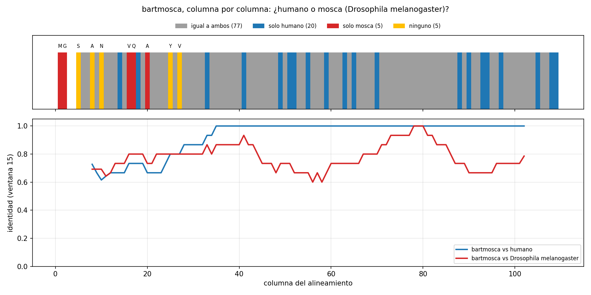
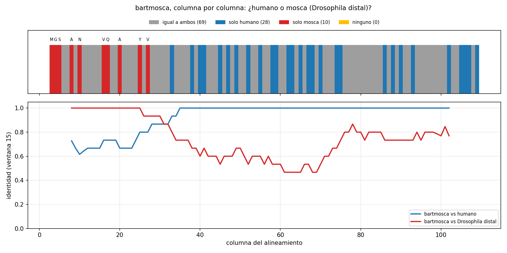
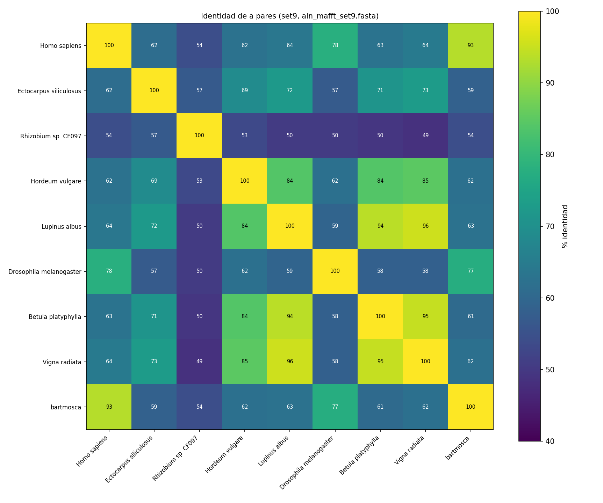
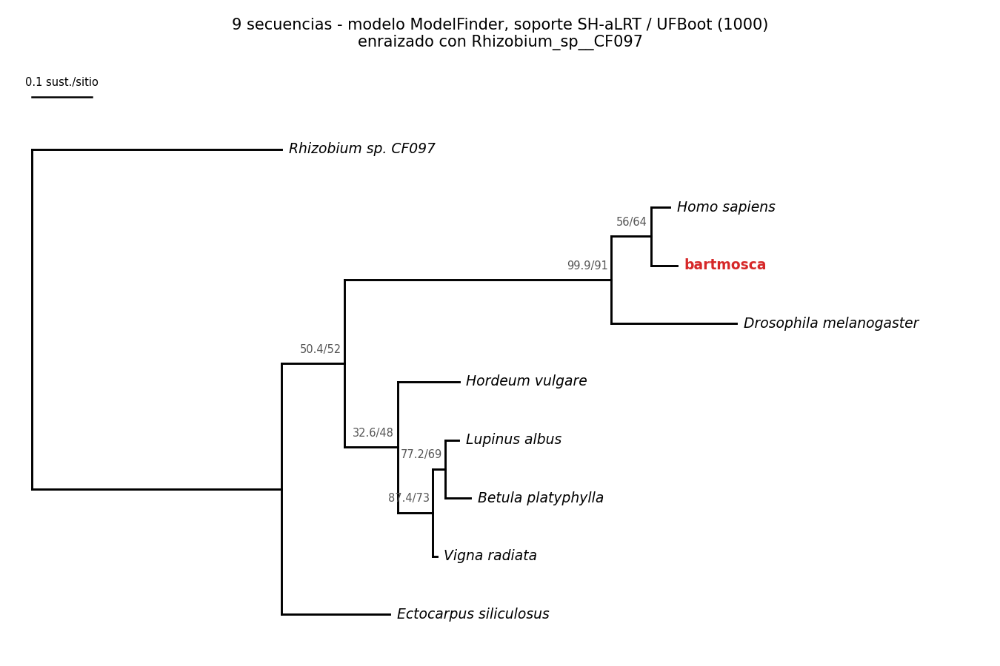

# TP: Inferencias evolutivas — el caso del bartmosca

Resolución del TP [Inferencias evolutivas](https://github.com/AJVelezRueda/Introduccion_a_la_Bioinformatica/blob/master/Teorico_Practicos/Inferencias_evolutivas/inferencias_evolutivas.md)
(Dra. Ana Julia Velez Rueda y Guillermo I. Benítez).

> ⚠️ **Sobre el enunciado:** dice que al niño mosca se le secuenció el *Cyt P450*,
> pero tanto [`SecuenciasCytocromoC.fasta`](datos/SecuenciasCytocromoC.fasta) como la
> secuencia de bartmosca son de **citocromo c** (la misma proteína del TP
> "¿En qué se parecen una gallina y una mosca?"). Trabajé con las secuencias que
> acompañan al TP.

> 📝 **Herramientas usadas:**
> - **Alineamiento:** el servicio de Clustal Omega del EBI bloqueó temporalmente
>   los envíos desde mi conexión (política de *fair use*) mientras hacía el TP. Por
>   eso los alineamientos están hechos con **MAFFT L-INS-i** local (otro alineador
>   múltiple estándar, en su modo más preciso). `clustal_ebi.py` hace el pedido a
>   Clustal Omega por API; si se corre y deja `resultados/aln_set*.fasta`, el resto
>   de los scripts lo usa automáticamente en lugar del de MAFFT.
> - **Árboles:** en vez del servidor web de IQ-TREE usé **IQ-TREE 3.1.4 local**
>   (es el mismo programa que corre el servidor), con semilla fija para que sea
>   reproducible.
> - **Visualización:** los `.treefile` se abren directo en FigTree; además
>   `arboles.py` dibuja los árboles enraizados con matplotlib.

## Estructura

| Archivo | Qué hace |
|---|---|
| `secuencias.py` | Lee el FASTA del curso, pone etiquetas cortas (los encabezados originales tienen comas y corchetes que rompen el formato Newick) y arma los sets. Con `--descargar-distal` baja de NCBI el citocromo c *distal* de la mosca |
| `clustal_ebi.py` | Desafío II: Clustal Omega por la API REST del EBI |
| `mafft_local.py` | Desafío II: MAFFT L-INS-i local (el que se usó) |
| `comparar.py` | Desafío I: identidad, p-distancia, mosaico columna por columna, ventana deslizante y punto de corte de la quimera |
| `arboles.py` | Desafío III: corridas de IQ-TREE, lector Newick, enraizado con outgroup y figuras |
| `datos/` | FASTA del curso, la mosca distal (`NP_477164.1`) y los sets `set3` / `set4` / `set9` |
| `resultados/` | Alineamientos, tablas de identidad, figuras y salidas de IQ-TREE (`resultados/iqtree/`) |
| `tests/` | Tests con pytest (no necesitan internet ni IQ-TREE) |

Sets de secuencias:

- **set3**: humano, mosca (la del archivo del curso) y bartmosca. Es lo que pide el Desafío I.
- **set9**: las 9 secuencias del archivo ("el resto de las secuencias").
- **set4**: set3 + el citocromo c **distal** de *Drosophila* (ver Desafío I, por qué hizo falta).

### Cómo reproducirlo

Todos los comandos se corren desde esta carpeta (`cd inferencias_evolutivas`).

```bash
brew install mafft iqtree3                  # o con conda: -c bioconda mafft iqtree
python secuencias.py --descargar-distal     # arma set3, set4 y set9
python mafft_local.py set3 set4 set9        # (o: python clustal_ebi.py set3 set4 set9)
python comparar.py                          # Desafío I
python arboles.py                           # Desafío III (el bootstrap estándar de 1000 réplicas tarda ~35 min)
```

---

## 🧗 Desafío I: ¿qué le decimos a los padres?

### Tácticas y metodología

La pregunta de los padres es "¿cuánto de nuestro hijo sigue siendo humano?". Con
una sola secuencia no se puede contestar eso para todo el organismo (para eso
habría que mirar muchos genes, idealmente el genoma). Lo que sí se puede contestar
es **de dónde viene esta secuencia**. Los pasos que seguiría:

1. **Juntar secuencias de referencia:** el mismo gen (citocromo c) en humano y en
   mosca, y algunas especies más alejadas para tener contexto y un grupo externo.
2. **Alinear** todas las secuencias (alineamiento múltiple). Es el paso más
   delicado porque define qué posición se compara con cuál.
3. **Medir el parecido** de bartmosca con cada referencia: identidad y distancia.
4. **Mirar *dónde* está el parecido, no solo cuánto.** Si bartmosca fuera "mitad y
   mitad", podría ser parejo a lo largo de la secuencia o por regiones (un
   *mosaico* o quimera). Para eso: comparación columna por columna y una ventana
   deslizante.
5. **Árbol filogenético** con un modelo de sustitución y bootstrap, enraizado con
   un grupo externo, para ver con quién agrupa bartmosca y con qué confianza.
6. **Si hay mosaico, hacer un árbol por región:** si las regiones cuentan historias
   distintas, es la firma de una quimera.

### ¿Qué criterios se me ocurren para comparar las secuencias?

- **% de identidad:** residuos idénticos sobre columnas alineadas. Hay que aclarar
  siempre el denominador; acá uso las columnas donde ninguna de las dos tiene gap.
- **p-distancia** = 1 − identidad: la proporción de sitios distintos. Es simple,
  pero subestima la distancia real cuando hay muchos cambios, porque no ve las
  sustituciones múltiples en un mismo sitio. Por eso para los árboles se usan
  **distancias corregidas por un modelo** (las que estima IQ-TREE, Desafío III).
- **Similitud:** contar como "parecidos" los cambios conservativos (por ejemplo
  I↔V), usando una matriz de sustitución (PAM/BLOSUM).
- **Gaps:** cuántos indels hacen falta y dónde caen.
- **Distribución del parecido a lo largo de la secuencia**, para detectar regiones
  con orígenes distintos.

### ¿Qué resultados obtengo? (humano, mosca y bartmosca)

Con el alineamiento de las tres (`resultados/aln_mafft_set3.clustal`):

| Par | Identidad | p-distancia |
|---|---|---|
| bartmosca vs humano | **92.4%** | 0.076 |
| bartmosca vs mosca | 77.4% | 0.226 |
| humano vs mosca | 76.9% | 0.231 |

A primera vista bartmosca es "casi humano". Pero las **8 diferencias** con el humano
no están repartidas: **todas caen en los primeros 25 residuos** (S3, A6, N8, V14,
Q15, A18, Y23, V25). Desde la posición 26 hasta el final (82 residuos) bartmosca es
**idéntica** al citocromo c humano.



En los primeros 18 residuos bartmosca se parece más a la mosca (72.2% de identidad)
que al humano (55.6%), y en el resto pasa lo contrario (97.8% humano vs 77.5% mosca).
Eso ya sugiere un **mosaico**. Pero 5 de esas 8 posiciones (S3, A6, N8, Y23, V25)
**no coinciden con ninguno de los dos**: con la mosca del archivo el mosaico no
termina de cerrar.

**La pista: parálogos.** La mosca del archivo del curso es el citocromo c
*proximal* (`NP_001285984.1`). *Drosophila* tiene **otra copia** del gen, el
citocromo c *distal* (`NP_477164.1`, lo vimos en el TP de la gallina y la mosca).
Son **parálogos**: dos genes de la misma especie que vienen de una duplicación (la
introducción del TP explica la diferencia con los ortólogos). Al comparar contra el
distal (`set4`):

- Los **primeros 30 residuos** de bartmosca son **idénticos** a los del citocromo c
  distal de la mosca (`MGSGDAENGKKIFVQKCAQCHTYEVGGKHK`).
- Del residuo 26 en adelante es idéntica al humano. El tramo 26–30 (`GGKHK`) es igual
  en las dos, así que el punto de unión está en algún lugar entre la posición 25 y la 30.
- Un modelo de quimera con un solo corte (mosca distal → humano) **explica los
  107 de 107 residuos**, sin ningún cambio propio.



**Prueba con árboles por región** (`set4`, modelo DAYHOFF+G4, UFBoot 1000). Separé
el alineamiento en el N-terminal (posiciones 1–25 de bartmosca) y el resto
(31–107), dejando afuera el tramo ambiguo:

| Región | Sitios | bartmosca agrupa con | UFBoot |
|---|---|---|---|
| N-terminal (1–25) | 25 | mosca **distal** | 94 |
| Resto (31–107) | 77 | **humano** | 99 |

Las dos regiones cuentan historias distintas. Esa **incongruencia** es la firma de
una secuencia quimérica.

**Respuesta para los padres:** el citocromo c del niño no es un "intermedio" entre
humano y mosca. Es un **gen humano** (≈77% de la secuencia, sin un solo cambio) **con
los primeros ~25–30 aminoácidos reemplazados** por los del citocromo c distal de la
mosca. Un corte tan limpio no es lo que produce la evolución (dos especies tan
lejanas no intercambian pedazos de genes). Lo más probable es que sea un **artefacto**:
contaminación de la muestra, una quimera de PCR o un error al ensamblar la secuencia.
Antes de concluir nada sobre el niño, conviene **volver a secuenciar** a partir de
una muestra nueva. Y en cualquier caso, un solo gen no dice "cuánto" del organismo es
mosca.

### ¿Qué esperaría con el resto de las secuencias? ¿Por qué?

Esperaría que el árbol reflejara la historia de las especies:

- bartmosca junto al **humano** (por el 92–93% de identidad);
- después la **mosca**, completando el grupo de los animales;
- las cuatro **plantas** juntas (cebada *Hordeum*, una monocotiledónea, y tres
  eudicotiledóneas: *Lupinus*, *Vigna* y *Betula*);
- el **alga parda** *Ectocarpus*, otro eucariota, más lejos;
- y la **bacteria** *Rhizobium* como la más distinta de todas. Sirve como grupo
  externo porque las mitocondrias (donde trabaja el citocromo c de los eucariotas)
  derivan de una alfaproteobacteria, el mismo grupo al que pertenece *Rhizobium*.

¿Por qué? Porque el citocromo c es una proteína esencial y muy conservada (trabaja
en la cadena respiratoria), que cambia despacio y de manera bastante regular. Eso
la hace útil para comparar organismos muy lejanos: con 9 secuencias el alineamiento
tiene 131 sitios, de los cuales **57 son constantes** y 45 son informativos para
parsimonia.

**Lo que obtengo** (`set9`, identidad de bartmosca contra cada una):

| bartmosca vs | Identidad |
|---|---|
| *Homo sapiens* | 93.3% |
| *Drosophila melanogaster* | 77.4% |
| *Lupinus albus* | 62.6% |
| *Hordeum vulgare* | 62.3% |
| *Vigna radiata* | 62.3% |
| *Betula platyphylla* | 60.7% |
| *Ectocarpus siliculosus* | 58.7% |
| *Rhizobium* sp. CF097 | 54.4% |

El gradiente es el esperado: humano > mosca > plantas ≈ alga > bacteria.

> **Ojo:** con 9 secuencias la identidad bartmosca–humano pasa de 92.4% a 93.3%.
> Las secuencias son las mismas: lo que cambió es cómo quedó alineado el N-terminal
> al sumar las demás. **La identidad depende del alineamiento.**



---

## 🧗 Desafío II: alineamiento

Alineamiento de las 3 secuencias (`resultados/aln_mafft_set3.clustal`):

```
Homo_sapiens    ----MGDVEKGKKIFIMKCSQCHTVEKGGKHKTGPNLHGLFGRKTGQAPGYSYTAANKNK
Drosophila_mela MGVPAGDVEKGKKLFVQRCAQCHTVEAGGKHKVGPNLHGLIGRKTGQAAGFAYTDANKAK
bartmosca       MG--SGDAENGKKIFVQKCAQCHTYEVGGKHKTGPNLHGLFGRKTGQAPGYSYTAANKNK
                     **.*:***:*: :*:**** * *****.*******:*******.*::** *** *

Homo_sapiens    GIIWGEDTLMEYLENPKKYIPGTKMIFVGIKKKEERADLIAYLKKATNE
Drosophila_mela GITWNEDTLFEYLENPKKYIPGTKMIFAGLKKPNERGDLIAYLKSATK-
bartmosca       GIIWGEDTLMEYLENPKKYIPGTKMIFVGIKKKEERADLIAYLKKATNE
                ** *.****:*****************.*:** :**.*******.**:
```

Lo que se ve:

- Los gaps y casi todos los cambios están en el **extremo N-terminal**. Es la región
  menos conservada y la más difícil de alinear: hay más de una forma razonable de
  ubicar los gaps.
- Se conservan el motivo **CXXCH** (`CSQCH`, posiciones 15–19 del humano contando la
  Met inicial), donde se une covalentemente el grupo hemo, y la **Met81**, que
  coordina al hierro del hemo. Estos son los residuos que no pueden cambiar sin
  romper la función.
- El tramo `PKKYIPGTKM` es idéntico en las tres.

El alineamiento de las 9 (`resultados/aln_mafft_set9.clustal`) tiene 131 columnas,
31 con algún gap. La mayoría de esos gaps vienen de dos extensiones del N-terminal:
la de las plantas (`MAS…`) y, sobre todo, la de *Rhizobium*
(`MRNQILMIGLSAAVLCPIGALAQ…`). Esta última tiene pinta de **péptido señal**: en
bacterias, el citocromo c se exporta al periplasma, así que no tiene equivalente en
las proteínas mitocondriales.

> **Para reproducirlo en la web de Clustal Omega:** pegar
> [`datos/set3.fasta`](datos/set3.fasta) (o `set9.fasta`) en
> https://www.ebi.ac.uk/Tools/msa/clustalo/ → *Submit*. También se puede correr
> `python clustal_ebi.py set3 set9`. Para secuencias tan parecidas como estas,
> Clustal y MAFFT dan alineamientos casi iguales; donde pueden diferir es en
> dónde ubican los gaps del N-terminal.

---

## 🧗 Desafío III: árboles con IQ-TREE

### ¿A qué se refiere el modelo de sustitución?

Un **modelo de sustitución** es la descripción matemática de cómo cambian los
aminoácidos con el tiempo. Define con qué probabilidad un aminoácido se reemplaza por
otro a lo largo de una rama. Tiene tres componentes:

1. **Matriz de intercambio:** qué tan probable es cada cambio. Para proteínas se usan
   matrices empíricas, estimadas a partir de muchos alineamientos reales: Dayhoff
   (PAM), JTT, WAG, LG. Los cambios entre aminoácidos parecidos (I↔V, D↔E) son mucho
   más frecuentes que entre muy distintos (W↔G). El modelo **Poisson** es el caso más
   simple: supone que todos los cambios son igual de probables.
2. **Frecuencias de aminoácidos** de equilibrio.
3. **Heterogeneidad entre sitios:** no todas las posiciones evolucionan igual de
   rápido (el CXXCH casi no cambia; el N-terminal cambia mucho). `+G4` lo modela con
   una distribución gamma de 4 categorías, `+I` agrega una proporción de sitios
   invariables y `+R` usa categorías libres.

El modelo importa porque con él se estiman las **distancias reales**, corrigiendo los
cambios múltiples en un mismo sitio que la p-distancia no ve. IQ-TREE puede
elegirlo solo con **ModelFinder** (`-m MFP`), que prueba muchos modelos y se queda con
el de mejor BIC. Para las 9 secuencias:

| Modelo | BIC (menor es mejor) |
|---|---|
| **DAYHOFF+G4** (elegido) | **2303.7** |
| DCMUT+G4 | 2303.8 |
| WAG+G4 | 2312.6 |
| LG+G4 | 2325.6 |
| JTT+G4 | 2338.5 |
| Poisson | 2563.0 |

Ganó la matriz de Dayhoff (DCMut es una reimplementación de la misma, por eso le
sigue tan de cerca), con un parámetro gamma α = 1.13: hay bastante diferencia de
velocidad entre sitios. Poisson queda lejísimos.

**¿Cambia algo usar un modelo peor?** Sí. Con Poisson el árbol mide 1.62
sustituciones/sitio en total contra 2.24 con DAYHOFF+G4: Poisson **subestima las
distancias**. Además cambia la topología en la parte profunda: con DAYHOFF+G4 el alga
*Ectocarpus* queda junto a *Rhizobium*, y con Poisson queda junto a las plantas. Las
dos agrupaciones tienen soporte bajo (ver abajo).

### ¿Qué es el bootstrap? ¿Qué dice de la calidad del árbol?

El **bootstrap** mide qué tan bien sostienen los datos a cada rama del árbol. Se arman
muchos alineamientos "de mentira" sorteando columnas **con reposición** del
alineamiento original (algunas columnas salen repetidas y otras no salen), se hace un
árbol con cada uno y se cuenta en qué porcentaje de esas réplicas aparece cada grupo.

- Un **valor alto** (≥70% en bootstrap estándar) significa que la señal a favor de ese
  grupo está repartida en muchas columnas: sacar o repetir algunas no lo cambia.
- Un **valor bajo** significa que el grupo depende de pocas columnas o que hay señal
  contradictoria. Esa rama no es confiable.

No dice si el árbol es "verdadero": dice qué tan **estable** es cada grupo frente a
los datos que tenemos. Un error sistemático (por ejemplo, un mal modelo) puede dar
soportes altos para un grupo equivocado.

IQ-TREE ofrece además dos medidas más rápidas: **UFBoot** (*ultrafast bootstrap*, se
confía a partir de ≥95) y el test **SH-aLRT** (a partir de ≥80). Los umbrales son
distintos porque las escalas no son equivalentes a las del bootstrap estándar.

### ¿Cómo influye el número de réplicas?

Corrí el mismo árbol (mismo modelo, misma semilla) con 10, 100 y 1000 réplicas de
bootstrap estándar:

| Grupo (árbol enraizado) | b = 10 | b = 100 | b = 1000 | SH-aLRT / UFBoot |
|---|---|---|---|---|
| animales (humano, bartmosca, mosca) | 90 | 88 | 88 | 99.9 / 91 |
| humano + bartmosca | 50 | 47 | 47 | 56 / 64 |
| eudicotiledóneas (*Lupinus*, *Betula*, *Vigna*) | 90 | 79 | 85 | 87.4 / 73 |
| *Lupinus* + *Betula* | 70 | 58 | 63 | 77.2 / 69 |
| plantas (las 4) | 40 | 45 | 43 | 32.6 / 48 |
| todos menos *Ectocarpus* y *Rhizobium* | 20 | 39 | 47 | 50.4 / 52 |

- **El número de réplicas no mejora el árbol:** el árbol es el mismo en las tres
  corridas. Lo que cambia es la **precisión con la que se estima el soporte**.
- Con **10 réplicas** los valores solo pueden ser múltiplos de 10 y son muy
  ruidosos. Por ejemplo, el grupo "todos menos *Ectocarpus* y *Rhizobium*" da 20 con
  10 réplicas, 39 con 100 y 47 con 1000. De 10 a 100 réplicas los soportes se
  movieron hasta 19 puntos; de 100 a 1000, como mucho 8.
- O sea, **con más réplicas la estimación converge**. Por eso se recomiendan al
  menos 1000 réplicas (o UFBoot 1000), a cambio de más tiempo de cómputo: acá pasar
  de 100 a 1000 réplicas llevó el cálculo de 3,6 a 35,5 minutos. UFBoot con 1000
  réplicas tardó segundos: por eso existe.

### Interpretación de los árboles



(Los números en cada nodo son SH-aLRT / UFBoot.)

- **bartmosca queda junto al humano** en todos los árboles (DAYHOFF+G4, Poisson,
  bootstrap estándar). El soporte de ese par es **moderado-bajo** (SH-aLRT 56, UFBoot
  64, bootstrap 47 con 100 y con 1000 réplicas). Tiene sentido: bartmosca y humano solo difieren en
  el N-terminal, y en esas posiciones bartmosca tiene residuos de mosca. Algunas
  columnas tiran a bartmosca hacia el humano y otras hacia la mosca, y esa **señal
  contradictoria** baja el soporte. Es la misma quimera del Desafío I, vista desde el
  árbol.
- **Animales** (humano, bartmosca, mosca) forman un grupo bien sostenido (SH-aLRT
  99.9, UFBoot 91).
- Las **eudicotiledóneas** se agrupan con soporte aceptable. Lo que no se resuelve
  bien es el orden interno (*Lupinus* con *Betula* o con *Vigna*) ni la posición de
  *Hordeum*: las plantas difieren entre sí en muy pocos residuos.
- La parte profunda (dónde va *Ectocarpus*) tiene **soporte bajo** y **cambia con el
  modelo**. Con DAYHOFF+G4, *Ectocarpus* queda junto a *Rhizobium*, probablemente por
  **atracción de ramas largas**: la rama de *Rhizobium* es la más larga del árbol
  (~0.83 sustituciones/sitio) y tiende a "arrastrar" a otras ramas largas. Con
  Poisson, *Ectocarpus* queda con las plantas, que es lo esperable según la filogenia
  aceptada de los eucariotas. Una sola proteína de ~105 aminoácidos no alcanza para
  resolver relaciones tan antiguas.

**El set de 3 (humano, mosca, bartmosca):** con 3 secuencias hay **una sola topología
posible** sin raíz (una estrella con tres ramas). No hay nada que "resolver" ni un
bootstrap que calcular; lo único informativo son los **largos de rama**. En el árbol
de `set3_mfp` bartmosca cuelga a 0.036 sust./sitio del centro, el humano a
0.049 y la mosca a 0.237. bartmosca y humano están cerca entre sí y lejos de
la mosca.

### ¿Hace falta algún paso extra antes de interpretar el árbol? ¿Por qué?

Sí: **enraizarlo**. IQ-TREE (como casi todos los métodos de máxima verosimilitud y
distancia) devuelve un árbol **sin raíz**: dice qué secuencias están más cerca, pero
no hacia dónde corre el tiempo. El dibujo que muestra por defecto arranca desde un
nodo cualquiera, y leído así sugiere relaciones de ancestro/descendiente que no son
reales. Para enraizarlo se elige un **grupo externo** (*outgroup*): una secuencia que
sabemos que se separó antes que todas las demás. Acá es *Rhizobium*, la única
bacteria del set. La raíz va en la rama que lo une con el resto. Recién entonces se
pueden leer los clados como "ancestro común + todos sus descendientes".

En **FigTree**: abrir `resultados/iqtree/set9_mfp.treefile` → cuando pregunta por las
etiquetas de los nodos, ponerles un nombre (por ejemplo `soporte`) → seleccionar la
rama de *Rhizobium* → botón **Reroot** → activar *Node Labels* y mostrar `soporte`.
`arboles.py` hace lo mismo y guarda el árbol enraizado en
`resultados/iqtree/set9_mfp_enraizado.nwk`.

Otros pasos que conviene hacer antes de interpretar:

- **Revisar el alineamiento.** Por ejemplo, el péptido señal de *Rhizobium* no tiene
  equivalente en las demás y solo agrega columnas con gaps. Se podrían recortar esas
  columnas.
- **Mirar los soportes** y no sacar conclusiones de las ramas con valores bajos.

---

## Tests

```bash
python -m pytest tests -v
```

## Bibliografía

- Katoh, K. y Standley, D. M. 2013. MAFFT multiple sequence alignment software version 7. *Molecular Biology and Evolution* 30(4), pp. 772–780.
- Minh, B. Q. et al. 2020. IQ-TREE 2: new models and efficient methods for phylogenetic inference in the genomic era. *Molecular Biology and Evolution* 37(5), pp. 1530–1534.
- Kalyaanamoorthy, S. et al. 2017. ModelFinder: fast model selection for accurate phylogenetic estimates. *Nature Methods* 14(6), pp. 587–589.
- Hoang, D. T. et al. 2018. UFBoot2: improving the ultrafast bootstrap approximation. *Molecular Biology and Evolution* 35(2), pp. 518–522.
- Felsenstein, J. 1985. Confidence limits on phylogenies: an approach using the bootstrap. *Evolution* 39(4), pp. 783–791.
