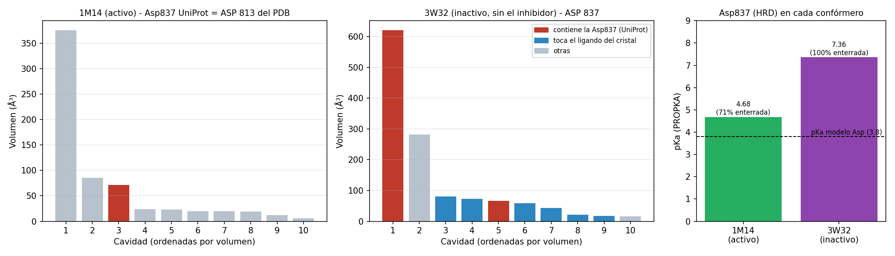
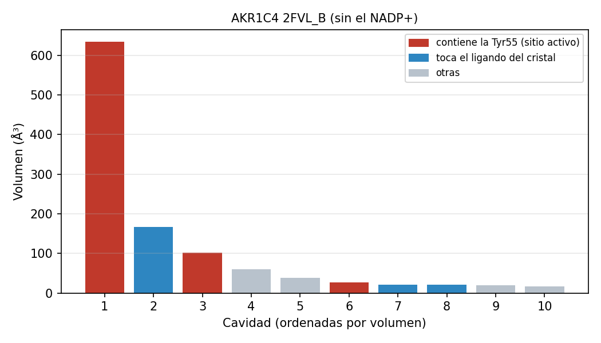
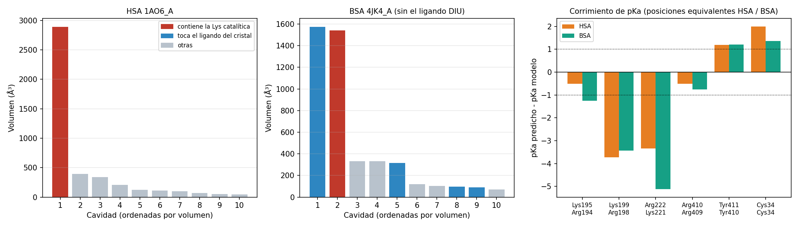
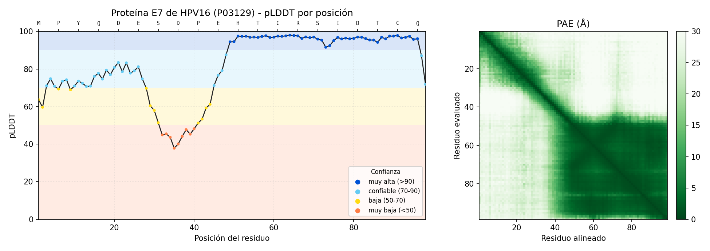

# TP: La vida en tres dimensiones

Resolución del TP [La vida en tres dimensiones](https://github.com/AJVelezRueda/Introduccion_a_la_Bioinformatica/blob/master/Teorico_Practicos/Bioinform%C3%A1tica_Estructural/La_vida_en_tres_dimensiones.md)
(Dra. Ana Julia Velez Rueda y Nicolás Palopoli).

Es un TP de **bioinformática estructural**: se arranca mirando a mano un archivo
PDB (la ubiquitina) y se termina analizando cavidades, pKa anómalos y un modelo
de AlphaFold2. Para no quedarme en "lo que muestra la web", bajé todas las
estructuras y las analicé con scripts propios, de modo que cada número del
informe se pueda reproducir.

## Estructura

| Archivo | Qué resuelve |
|---|---|
| `explorar_pdb.py` | PARA PENSAR de la ubiquitina: parser del formato PDB (método, resolución, SEQRES vs. coordenadas, estructura 2ria, factor B) |
| `numeracion.py` | La trampa de todo el TP: numeración PDB vs. UniProt y equivalencias HSA↔BSA por alineamiento |
| `sitios_uniprot.py` | Desafío II: sitios biológicamente relevantes desde la API de UniProt |
| `cavidades.py` | Desafíos I, III, IV y V: detección de cavidades + pKa por residuo (PROPKA) |
| `figuras_cavidades.py` | Figuras de los desafíos de cavidades (lee los CSV, corre offline) |
| `plddt.py` | Desafío VI: gráfico de pLDDT por posición (y PAE) de un modelo de AlphaFold2 |
| `descargar_estructuras.py` | Vuelve a bajar todos los datos (PDB, UniProt, AlphaFold DB) |
| `datos/` | `1UBQ.pdb`, `estructuras/` (1M14, 3W32, 2FVL, 1AO6, 4JK4), `uniprot/`, `alphafold/` |
| `resultados/` | CSV de cavidades y residuos, salidas de PROPKA, figuras |
| `tests/` | Tests con pytest |

Todos los comandos se corren **desde esta carpeta** (`cd la_vida_en_tres_dimensiones`).

> ### ⚠️ Sobre CaviDB: qué usé y por qué
>
> El TP pide trabajar con [CaviDB](https://www.cavidb.org), pero **el sitio no
> respondió en ningún momento desde mi máquina** (`cavidb.org` redirige a
> `www.cavidb.org` y ahí la conexión queda colgada hasta el timeout; probado
> varias veces a lo largo de la resolución). Tampoco pude instalar **Fpocket**,
> que es el detector que CaviDB usa por debajo.
>
> Entonces reproduje **la misma lógica** de CaviDB con herramientas instalables
> por pip. Según su paper (Velez Rueda, Bulgarelli, Palopoli y Parisi, *Database*
> 2023, [doi:10.1093/database/baad010](https://doi.org/10.1093/database/baad010),
> PMID 37162753), CaviDB:
> 1. predice cavidades con **Fpocket** (parámetros por defecto),
> 2. considera **drogable** a la cavidad con *affectability* > 0.5,
> 3. estima pKa con **PROPKA** y calcula el *net pKa shift* por cavidad como la
>    suma de los |pKa predicho − pKa modelo| de sus residuos ionizables.
>
> Mi versión usa **pyKVFinder 0.9.7** (otro detector de cavidades, que da volumen,
> área, profundidad e hidropatía) y **PROPKA 3.5.1** (la misma herramienta que
> CaviDB). Los pasos 1 y 3 son equivalentes; el 2 **no**, porque pyKVFinder no
> calcula un *drug score*: donde el TP pregunta "¿es drogable?" respondo con un
> criterio explícito (volumen + profundidad + entorno hidrofóbico + que tape un
> sitio funcional) y lo aclaro cada vez.
>
> **Los números no son idénticos a los de CaviDB** (distinto detector, distinta
> grilla). Dejo en cada desafío el link directo a la entrada de CaviDB para
> comparar cuando el servicio vuelva:
> [1M14_A](https://www.cavidb.org/search?q=1M14A) ·
> [3W32_A](https://www.cavidb.org/search?q=3W32A) ·
> [2FVLB](https://www.cavidb.org/chains/62b9e24ad5e54dd8755ed134?q=2FVLB) ·
> [1AO6A](https://www.cavidb.org/search?q=1AO6A) ·
> [4JK4A](https://www.cavidb.org/search?q=4JK4A)

---

## 🤔 Para pensar: ¿por qué una célula querría destruir sus propias proteínas?

Porque una proteína no es para siempre: tenerla de más, o rota, es tan malo como
no tenerla. La degradación dirigida (la que marca justamente la ubiquitina) sirve
para:

- **Control de calidad:** sacar de circulación proteínas mal plegadas o dañadas
  antes de que se agreguen y resulten tóxicas.
- **Regulación temporal:** muchas proteínas tienen que *dejar* de estar. Las
  ciclinas del ciclo celular o los factores de transcripción se degradan para
  terminar una etapa; si no se destruyen, la señal nunca se apaga.
- **Reciclado:** recuperar aminoácidos para sintetizar otras proteínas, sobre
  todo si falta alimento.
- **Defensa y señalización:** los péptidos que salen de la degradación se
  presentan en el MHC-I, así que destruir proteínas propias es también la forma
  de mostrar qué se está fabricando adentro.

## 🤔 Para pensar: ¿qué información nos provee la página de 1UBQ?

Todo lo que hace falta para saber **de dónde salió** la estructura y **cuánto
confiar** en ella. En vez de copiar lo que muestra la web, lo saqué del archivo:

```bash
python explorar_pdb.py                     # datos/1UBQ.pdb
```

```
Entrada      : 1UBQ  (CHROMOSOMAL PROTEIN, 02-JAN-87)
Título       : STRUCTURE OF UBIQUITIN REFINED AT 1.8 ANGSTROMS RESOLUTION
Método       : X-RAY DIFFRACTION
Resolución   : 1.8 Å
R-work/R-free: 0.176 / None
DBREF        : cadena A 1-76 -> UNP P62988 1-76
Cadenas      : A
Átomos       : 602 ATOM, 58 HETATM (58 de agua)
Elementos    : {'N': 105, 'C': 378, 'O': 118, 'S': 1}
SEQRES (A)  : 76 aa  MQIFVKTLTGKTITLEVEPSDTIENVKAKIQDKEGIPPDQQRLIFAGKQLEDGRTLSDYNIQKESTLHLVLRLRGG
Desde CA (A): 76 aa  MQIFVKTLTGKTITLEVEPSDTIENVKAKIQDKEGIPPDQQRLIFAGKQLEDGRTLSDYNIQKESTLHLVLRLRGG
Estructura 2ria: hebra β 1-7; hebra β 10-17; hélice α 23-34; hebra β 40-45; hebra β 48-50; hélice 3-10 56-59; hebra β 64-72
Factor B (CA)  : medio 10.6 Ų, máximo 36.2 Ų en el residuo 76
```

Es decir: identificador, título y fecha, organismo (*Homo sapiens*), autores
(Vijay-Kumar, Bugg y Cook), método, resolución, calidad del refinamiento
(R = 0.176), la secuencia, los ligandos/solvente (acá solo 58 aguas), el link a
UniProt (**P62988**) y la referencia bibliográfica.

## 🤔 Para pensar: ¿cómo se determinó la estructura?

Por **difracción de rayos X** (`EXPDTA X-RAY DIFFRACTION`), refinada a **1.8 Å**.
Se cristaliza la proteína, se la irradia, se mide el patrón de difracción y de ahí
se reconstruye el mapa de densidad electrónica donde se "encaja" el modelo atómico.

## 🤔 Para pensar: ¿qué significan las cintas, las flechas y las regiones angostas?

Es la representación **cartoon**, que no dibuja átomos sino el recorrido de la
cadena principal para que se vea la estructura secundaria:

| Dibujo | Qué es | En 1UBQ |
|---|---|---|
| Cinta enrollada (resorte) | hélice α | 23–34 (la única hélice larga) |
| Flecha plana | hebra β; la punta apunta al C-terminal | 1–7, 10–17, 40–45, 48–50, 64–72 |
| Hilo angosto | loops y giros, sin estructura regular | lo que conecta todo, más la cola 71–76 |

Esos elementos salen de los registros `HELIX` y `SHEET` del propio archivo (los
lista el script). Las cinco hebras forman una lámina β mixta sobre la que se
apoya la hélice: es el plegamiento **β-grasp**, típico de la ubiquitina.

## 🤔 Para pensar: ¿representa esa imagen la realidad del sistema biológico?

No del todo, y conviene tenerlo presente:

- Es un **modelo**, no una foto: son coordenadas ajustadas a un mapa de densidad.
- Es **estática**, y la proteína en solución se mueve. El propio archivo lo
  delata: el factor B promedio de los Cα es 10.6 Ų, pero sube a **36.2 Ų en el
  residuo 76**, que es la cola C-terminal (la Gly76 que justamente se une a las
  proteínas que hay que degradar). Más factor B = más movilidad/incertidumbre.
- Es la proteína **en un cristal**, empaquetada contra sus vecinas y en un
  solvente artificial, no en el citoplasma lleno de otras macromoléculas.
- La imagen *cartoon* además **oculta** cosas: no se ven los hidrógenos (a 1.8 Å
  ni se detectan), ni las 58 aguas, ni los estados alternativos de las cadenas
  laterales.

## 🤔 Para pensar: utilidad y condicionamientos de un modelo que sabemos inexacto

Primero una aclaración sobre la consigna: en cristalografía, **cuanto más chico
es el número en Å, mejor es la resolución**. 1.8 Å es una resolución buena (se ve
bien el esqueleto y casi todas las cadenas laterales); a 3.5 Å ya no se
distinguirían. Lo que crece con el número es el error.

- **Utilidad:** aun sabiendo que es aproximado, alcanza para entender el
  plegamiento, ubicar el sitio activo, explicar el efecto de una mutación,
  diseñar fármacos y generar hipótesis experimentales. Un modelo útil no es un
  modelo exacto: es uno cuyo error conocés.
- **Condicionamientos:** no hay que leer las coordenadas como posiciones fijas y
  exactas. A 1.8 Å no se puede afirmar la posición de un hidrógeno ni discutir
  distancias de enlace al centésimo de Å, y las zonas con factor B alto (como la
  cola 71–76) son directamente poco confiables. Por eso siempre hay que reportar
  resolución y R junto con la conclusión estructural.

## 🤔 Para pensar: el visor 3D vs. la imagen del resumen

- **Similitudes:** la misma proteína y, por defecto, la misma representación
  *cartoon*, con los mismos elementos de estructura secundaria.
- **Diferencias:** el visor es **interactivo** (rotar, zoom, seleccionar un
  residuo y ver su entorno), permite cambiar representación y coloreado, y
  muestra lo que la figura estática suele esconder, como las aguas del cristal o
  las unidades vecinas del empaquetamiento.

## 🤔 Para pensar: ¿para qué visualizar lo mismo de distintas maneras?

Porque cada representación contesta una pregunta distinta:

| Representación | Qué permite ver |
|---|---|
| Cartoon | plegamiento y topología (hélices, láminas) |
| Superficie | forma real, surcos y **cavidades**; dónde podría entrar un ligando |
| Varillas / esferas | enlaces, puentes de hidrógeno, geometría del sitio activo |
| Esferas de van der Waals | el volumen que la proteína realmente ocupa |

Y lo mismo con el color: por estructura secundaria, por cadena, por
hidrofobicidad, por carga, por conservación evolutiva o por factor B. Pintar por
factor B, por ejemplo, muestra de una qué partes son rígidas y cuáles se mueven.

## 🤔 Para pensar: ¿qué información esperaría de un experimento estructural?

Las **coordenadas (x, y, z)** de cada átomo, con su identidad química y a qué
residuo y cadena pertenece; los ligandos, iones y aguas que se vieron; y los
**metadatos de calidad**: método, resolución, R-work/R-free, factor B por átomo y
ocupación. Sin esa segunda parte el modelo no es interpretable, porque no se sabe
cuánto creerle.

## 🤔 Para pensar: ¿en qué consiste un archivo PDB?

Es **texto plano en columnas fijas** (heredadas de las tarjetas perforadas de 80
columnas). Cada línea empieza con un tipo de registro:

```
HEADER / TITLE / COMPND / SOURCE   metadatos
EXPDTA                             método experimental
REMARK   2 RESOLUTION.             resolución
DBREF                              correspondencia con UniProt/GenBank
SEQRES                             secuencia completa de cada cadena
HELIX / SHEET                      estructura secundaria
ATOM / HETATM                      coordenadas (proteína / no proteína)
```

## 🤔 Para pensar: ¿qué información brinda la sección ATOM?

Una línea por átomo. Tomando la primera de 1UBQ:

```
ATOM      1  N   MET A   1      27.340  24.430   2.614  1.00  9.67           N
       │      │   │   │   │          │       │      │      │    │            │
   nº átomo  │  residuo│  nº residuo │       │      │   ocupación         elemento
          nombre    cadena           X       Y      Z         factor B
```

Es decir: número de serie, nombre del átomo (`N`, `CA`, `C`, `O`, cadenas
laterales), residuo, cadena, número de residuo, las tres coordenadas en Å, la
ocupación (fracción de moléculas con el átomo en esa posición) y el factor B
(movilidad/incertidumbre). `HETATM` tiene el mismo formato pero se usa para lo
que no es la cadena polimérica: ligandos, iones, agua. En 1UBQ los 58 `HETATM`
son todos agua (`HOH`).

## 🤔 Para pensar: ¿se puede extraer la estructura primaria? ¿Qué tipo de dato es?

Sí, y de **dos** maneras, que no siempre coinciden:

1. Los registros **`SEQRES`**, que declaran la secuencia completa de la cadena.
2. Leyendo los residuos de los **carbonos α** en orden en la sección `ATOM`, que
   es la secuencia que realmente **tiene coordenadas**.

En 1UBQ las dos dan lo mismo (76 aa, `MQIFVKTLTG...LRLRGG`), porque se resolvió
la proteína entera. En otras estructuras del TP no: 1AO6 declara 585 residuos por
cadena pero solo 578 tienen coordenadas (los extremos quedaron desordenados y se
anotan en `REMARK 465`). Por eso el script imprime las dos.

Se presenta con el código de **tres letras** (`MET GLN ILE PHE...`). Desde el
punto de vista computacional es una **secuencia de caracteres**: una lista de
strings de 3 letras, que se mapea a un string de 1 letra por aminoácido
(`tres_a_una()` en `explorar_pdb.py`). Es un dato **discreto y ordenado**: lo que
importa es el símbolo y su posición.

## 🤔 Para pensar: ¿es útil el formato PDB? Beneficios y limitaciones de una estructura rígida

**Sí, es útil**, y la prueba es que todo este TP se hizo parseándolo con unas
pocas líneas de Python, sin librerías especiales.

**Beneficios de imponer una estructura:**

- Cualquier programa sabe exactamente dónde buscar cada dato → **interoperabilidad**.
- Es legible por humanos y por máquinas a la vez.
- Permite acumular millones de entradas comparables entre sí: sin formatos
  estándar no existirían ni el PDB ni AlphaFold.
- Hace **reproducible** el análisis: el mismo archivo da el mismo resultado.

**Limitaciones:**

- Las columnas fijas imponen topes duros: 99.999 átomos, un solo carácter de
  cadena, 4 dígitos para el número de residuo. Un ribosoma o una cápside no
  entran, y por eso existe **mmCIF**, que es el formato oficial desde 2014.
- Lo que el formato no previó, no se puede expresar bien: mucha información
  termina como texto libre en `REMARK`, difícil de parsear.
- Un formato rígido **condiciona qué se considera un resultado**: obliga a
  entregar *un* conjunto de coordenadas, cuando una proteína en realidad es un
  ensamble de conformaciones.

## 🤔 Para pensar: ¿pasa lo mismo con los ácidos nucleicos? Rosalind Franklin

**Sí.** El PDB guarda ADN y ARN con el mismo formato. Lo comprobé con la
estructura **1BNA** (*Structure of a B-DNA dodecamer*, rayos X, 1.9 Å, 1981):

```
SEQRES   1 A   12   DC  DG  DC  DG  DA  DA  DT  DT  DC  DG  DC  DG
ATOM      1  O5'  DC A   1      18.935  34.195  25.617  1.00 64.35           O
```

Cambia el alfabeto (`DA DC DG DT` para desoxirribonucleótidos, `A C G U` para
ARN) y los nombres de átomos (`O5'`, `C5'`, `P`... en vez de `CA`, `N`), pero la
lógica es idéntica. Y el ARN además pliega estructuras terciarias complejas
(ribozimas, riboswitches) tan interesantes como las proteicas.

**Rosalind Franklin** es justamente quien hizo posible este tipo de dato. Su
aporte fue **metodológico**: trabajando con difracción de rayos X de fibras de
ADN, controló cuidadosamente la **humedad** de la cámara y así logró separar dos
formas que antes aparecían mezcladas, la **A** (deshidratada) y la **B**
(hidratada, la fisiológica). Tiró fibras finas y bien orientadas, usó tiempos de
exposición largos y analizó los patrones con funciones de Patterson. De ahí salió
en 1952 la **Fotografía 51**, cuya "X" es la firma de una hélice: de ese patrón se
podían derivar el carácter helicoidal, el paso de la hélice, su diámetro y que el
esqueleto azúcar-fosfato va por **afuera**. Watson y Crick usaron esos datos —que
vieron sin su consentimiento— para armar el modelo de doble hélice, y ella no
compartió el Nobel de 1962 (había muerto en 1958, a los 37). Vale como
recordatorio de que **el dato experimental y su autoría son parte del resultado
científico**, no un detalle previo.

---

# El futuro está aquí 📍

## 🧗 Desafío I: EGFR, confórmero activo (1M14) vs. inactivo (3W32)

> Comparar el sitio activo (posición **837**) y el tamaño de los pockets.

### ⚠️ Primero: el 837 de cada archivo no es el mismo residuo

Esto es lo que más me costó y es el corazón del ejercicio. El EGFR tiene un
péptido señal de 24 residuos, así que **UniProt numera el precursor** y algunos
PDB numeran la **proteína madura**. Lo saqué de los registros `DBREF`:

| Estructura | DBREF | Offset (UniProt − PDB) | ¿Dónde está la Asp837 de UniProt? |
|---|---|---|---|
| 1M14 | cadena A 671–998 → P00533 **695–1022** | **+24** | en la línea **`ASP 813`** |
| 3W32 | cadena A 696–1022 → P00533 **696–1022** | **0** | en la línea **`ASP 837`** |

Verificado contra la secuencia de UniProt (P00533 posición 837 = D, motivo
**HRD**: `...HRDLAA...`) y contra ambos archivos:

```bash
python sitios_uniprot.py P00533 --tipos "Active site" --pdb datos/estructuras/1M14.pdb --cadena A
```

> **Si uno se confía y mira el "837" del archivo 1M14, está mirando una LEU**
> (que es la Leu861 de UniProt). El test `test_asp837_de_uniprot_en_cada_pdb`
> deja esto fijado para que no se me escape.

UniProt anota a la Asp837 como **sitio activo, "Proton acceptor"**: es el
aspartato catalítico del motivo HRD, el que toma el protón del hidroxilo de la
tirosina sustrato. Alrededor están los otros residuos clave de la quinasa:
Lys745 (une ATP), Asp855 (del motivo DFG) y Thr790 (el *gatekeeper*).

### Cavidades

```bash
python cavidades.py --solo 1M14_A
python cavidades.py --solo 3W32_A
```

| | **1M14** (activo) | **3W32** (inactivo) |
|---|---|---|
| Resolución | 2.6 Å | 1.8 Å |
| Ligando en el cristal | ninguno (apo, solo 17 aguas) | inhibidor **W32** + sulfato |
| Cavidades detectadas | **10** | **17** |
| Volumen de la mayor | **375 ų** | **620 ų** |
| Volumen total | 655 ų | 1356 ų |
| Profundidad máx. de la mayor | 3.0 Å | **12.3 Å** |
| ¿Dónde cae la Asp837? | cavidad **3**, de solo **71 ų** | cavidades **1** (la mayor) y 5 |
| pKa de la Asp837 (PROPKA) | **4.68** (71 % enterrada) | **7.36** (100 % enterrada) |



**Observaciones (corridas):**

- En **1M14** el sitio catalítico está **abierto al solvente y poco definido**: la
  cavidad que contiene la Asp837 es chiquita (71 ų, profundidad 0 Å, hidropatía
  +0.29 = más bien polar) y la cavidad grande (375 ų) corre por la hendidura
  entre lóbulos pero es ancha y playa. Es lo esperable para una conformación
  activa en forma *apo*: el bolsillo existe pero está "abierto".
- En **3W32** la Asp837 forma parte de la **cavidad más grande y más profunda**
  (620 ų, 12.3 Å de profundidad, hidropatía −0.28 = marcadamente hidrofóbica),
  que es la misma que toca el inhibidor: de los 38 residuos que la tapizan, **21
  contactan al ligando W32** (Leu718, Gly719-Gly724 del *P-loop*, Lys745,
  Thr790, Met793 de la bisagra, Cys797, Asp855 del DFG). O sea: la cavidad
  "grande" del confórmero inactivo **es** el bolsillo del ATP ocupado por el
  inhibidor.
- El **pKa** es la diferencia más interesante: la misma aspártico pasa de **4.68**
  (cerca del 3.80 de una Asp libre) a **7.36**, con un corrimiento de **+3.6
  unidades**. En 3W32 está 100 % enterrada, en un entorno hidrofóbico que
  desestabiliza la forma cargada. A pH fisiológico eso la deja mayormente
  **protonada**, es decir **incapaz de actuar como aceptor de protones**, que es
  exactamente su función catalítica. Encaja con que esa estructura sea el
  confórmero inactivo.

> **Honestidad sobre esta comparación:** 1M14 es *apo* y 3W32 está **con
> inhibidor**. Aunque corrí la detección sobre la proteína sola (saqué los
> `HETATM`), el cristal con ligando ya trae el bolsillo "moldeado" alrededor de
> la droga, y además tiene mejor resolución (1.8 vs. 2.6 Å) y 10 residuos más
> ordenados. Parte de la diferencia de volumen es efecto de eso y no solo del
> cambio conformacional. La conclusión que sí me parece sólida es la del
> **entorno de la Asp837**: enterrada e hidrofóbica con pKa corrido en el
> inactivo, accesible y con pKa casi normal en el activo.

---

## 🧗 Desafío II: AKR1C4 en UniProt

> Las variantes de AKR1C4 están asociadas a trastorno bipolar, otros trastornos
> del ánimo y resistencia a medicamentos. Investigar la proteína y anotar los
> sitios relevantes.

```bash
python sitios_uniprot.py P17516 --pdb datos/estructuras/2FVL.pdb --cadena B
```

**Identificación:** `P17516` · gen **AKR1C4** · *Aldo-keto reductase family 1
member C4* · 323 aa · *Homo sapiens*. También se la llama **3-α-hidroxiesteroide
3-deshidrogenasa tipo I** (EC 1.1.1.357) y **chlordecone reductase** (EC
1.1.1.225).

**Función (UniProt):** aldo-ceto reductasa **citosólica** que cataliza la
reducción **dependiente de NADPH** de cetoesteroides a hidroxiesteroides. Tiene
especificidad amplia y genera 3α/β-, 17β- y 20α-hidroxiesteroides. Se expresa
sobre todo en **hígado**, y también en testículo y suprarrenal. Participa de la
vía "*backdoor*" de síntesis de andrógenos: mutaciones de *splicing* en AKR1C4
agravan el fenotipo del **46,XY sex reversal 8** (SRXY8, MIM 614279) en pacientes
con mutación causal en AKR1C2.

**Sitios biológicamente relevantes** (posiciones UniProt; coinciden 1:1 con la
numeración de la cadena B de 2FVL, que no tiene offset):

| Tipo | Posición | Residuos | Descripción |
|---|---|---|---|
| **Active site** | **55** | **Tyr** | **dador de protones** |
| Site | **84** | Lys | **baja el pKa de la Tyr del sitio activo** |
| Binding site | 20–24 | GFGTY | NADP(+) |
| Binding site | 50 | Asp | NADP(+) |
| Binding site | 166–167 | SN | NADP(+) |
| Binding site | 190 | Gln | NADP(+) |
| Binding site | 216–221 | HSALGT | NADP(+) |
| Binding site | 270–280 | KSYNEQRIREN | NADP(+) |

Las dos primeras filas son la clave del mecanismo y vuelven en el Desafío III: la
**tétrada catalítica** de las aldo-ceto reductasas es **Asp50 – Tyr55 – Lys84 –
His117**, donde la Tyr55 dona el protón y la Lys84 (ayudada por el Asp50) le baja
el pKa para que pueda hacerlo. La anotación de UniProt para la Lys84 lo dice con
todas las letras: *"Lowers pKa of active site Tyr"*.

**Variantes naturales anotadas:** G135E, S145C, C170Y, Q250R y L311V. UniProt
agrega que el alelo **Cys145/Val311** tiene una eficiencia catalítica **3 a 5
veces menor** que el alelo Ser145/Leu311 — justo el tipo de polimorfismo que
explicaría diferencias de respuesta a fármacos entre personas. La enzima además
es inhibida por **AINEs** como el ácido flufenámico.

> **Dato lindo que apareció solo:** al comparar la secuencia de P17516 con la de
> la cadena B de 2FVL encontré **exactamente dos diferencias**: posición 170
> (C→Y) y posición 250 (Q→R). No son errores: **son dos de las variantes
> naturales anotadas** (rs17851824 y rs4880718). O sea, la proteína cristalizada
> corresponde a un alelo distinto del de la secuencia de referencia.

---

## 🧗 Desafío III: cavidades de 2FVL cadena B

> ¿Cuántas cavidades se predicen? ¿Hay alguna drogable? ¿Coincide con algún sitio
> de relevancia biológica?

Entrada en CaviDB: [2FVLB](https://www.cavidb.org/chains/62b9e24ad5e54dd8755ed134?q=2FVLB)
(no accesible durante la resolución; ver la nota del principio).

```bash
python cavidades.py --solo 2FVL_B
```

La estructura es **AKR1C4 en complejo con NADP+** (rayos X, 2.4 Å, tres cadenas
A/B/C, un NADP por cadena). Analicé la **cadena B** sola y sin el cofactor.

**¿Cuántas cavidades?** **17** en la cadena B, con un volumen total de 1181 ų.



| Cavidad | Volumen | Área | Prof. máx. | Hidropatía | Residuos | Contactan NADP |
|---|---|---|---|---|---|---|
| **1** | **633 ų** | 448 Ų | **13.4 Å** | −0.05 | 30 | **21** |
| 2 | 167 ų | 179 Ų | 6.1 Š| +0.30 | 19 | 1 |
| 3 | 101 ų | 116 Ų | 3.1 Š| +0.14 | 19 | 2 |

**¿Hay alguna drogable?** Con el criterio que puedo calcular (volumen grande,
profundidad alta, entorno no polar y que tape un sitio funcional), **la cavidad 1
es claramente la candidata**: concentra el **54 % del volumen de todas las
cavidades**, es la más profunda por lejos (13.4 Å) y es la única con un entorno
hidrofóbico neto. Las demás son bolsillos superficiales de menos de 170 ų.

> No puedo dar el *drug score* de Fpocket ni el valor de *affectability* > 0.5
> que usa CaviDB, porque pyKVFinder no lo calcula. Lo que afirmo es que la
> cavidad 1 cumple los criterios estructurales de drogabilidad; el número exacto
> hay que mirarlo en CaviDB.

**¿Coincide con un sitio de relevancia biológica?** **Sí, de lleno.** La cavidad
1 contiene:

- **toda la tétrada catalítica**: Asp50, **Tyr55**, **Lys84**, His117;
- **14 de los residuos de unión a NADP(+) anotados en UniProt** (Gly22, Thr23,
  Tyr24, Asp50, Ser166, Asn167, Gln190, His216–Thr221, Lys270);
- el bolsillo hidrofóbico donde entra el esteroide (Trp86, Phe118, Trp227,
  Leu268, Val306, Met308);
- **21 de sus 30 residuos contactan al NADP+** del cristal (a ≤ 4 Å).

O sea: **la cavidad más grande y más drogable es el sitio activo**, que aloja a
la vez el cofactor y el sustrato esteroideo.

Y el detalle fino: los pKa de PROPKA confirman que esa cavidad está **activada**.

| Residuo | pKa modelo | pKa predicho | Corrimiento | Enterramiento |
|---|---|---|---|---|
| Asp50 | 3.80 | 3.99 | +0.19 | 100 % |
| **Tyr55** (dador de protones) | 10.00 | **11.24** | +1.24 | 100 % |
| **Lys84** | 10.50 | **12.27** | +1.77 | 100 % |
| His117 | 6.50 | **1.52** | **−4.98** | 100 % |

El *net pKa shift* de la cavidad 1 es **13.4**. La His117 con pKa 1.5 está
garantizadamente neutra a pH fisiológico, y la Tyr55 y la Lys84 tienen sus pKa
corridos hacia arriba por estar enterradas en un ambiente poco polar. Es el
microambiente que hace falta para la catálisis.

### 💡 Para investigar: ¿en qué consiste el docking?

El **docking molecular** es un método computacional que predice **cómo y cuán
fuerte** se une una molécula chica (ligando) a una macromolécula (receptor).
Dadas las dos estructuras, busca la **pose** —posición, orientación y
conformación del ligando dentro del bolsillo— más favorable, y le asigna un
puntaje.

**En qué ideas se basa:** son dos piezas.

1. Un **algoritmo de búsqueda** que explora el espacio de poses: traslaciones,
   rotaciones y torsiones de los enlaces rotables del ligando (algoritmos
   genéticos, Monte Carlo, búsqueda sistemática). El espacio es enorme, así que
   casi siempre se trata al receptor como rígido o semi-rígido, que es la
   simplificación más fuerte del método.
2. Una **función de scoring** que estima la energía libre de unión a partir de
   términos fisicoquímicos: van der Waals, electrostática, puentes de hidrógeno,
   desolvatación y penalización por la entropía que pierde el ligando al fijarse.

Detrás está la hipótesis de **complementariedad**: el mejor ligando es el que
encaja en forma y en propiedades (hidrofóbico contra hidrofóbico, dador contra
aceptor de puente de hidrógeno) con la cavidad. Por eso el paso previo es
justamente el de este desafío: **encontrar y caracterizar la cavidad**.

**Cómo se aprovecharía acá:** AKR1C4 está ligada a trastornos del ánimo y a
resistencia a fármacos, y produce neuroesteroides. Con la cavidad 1 ya
identificada se puede hacer **cribado virtual**: dockear bibliotecas de millones
de compuestos contra ese bolsillo, quedarse con los mejor puntuados y pasarlos a
ensayo experimental. Eso sale mucho más barato que testear todo en mesada. El
problema difícil no es encontrar *un* inhibidor sino uno **selectivo**: las
isoformas AKR1C1, AKR1C2 y AKR1C3 son casi idénticas, así que hay que dockear
contra las cuatro y buscar compuestos que aprovechen las pocas diferencias del
bolsillo. Un detalle útil: como la cavidad aloja también al NADP+, se puede
diseñar contra el sitio del cofactor, contra el del esteroide, o buscar
inhibidores no competitivos en cavidades alostéricas.

**Limitaciones que hay que decir:** las funciones de scoring correlacionan
pobremente con la afinidad real, el receptor rígido ignora el *induced fit*, y
casi nunca se modela bien el agua estructural. El docking **prioriza**
candidatos, no los valida.

---

## 🧗 Desafío IV: albúmina humana (1AO6, cadena A)

> ¿Cuántas cavidades? ¿Cuáles son las principales por tamaño? ¿Hay cavidades que
> se solapen con los residuos relevantes para la actividad enzimática? ¿Están
> activadas? ¿Qué rangos de pKa se observan?

Entrada en CaviDB: [1AO6A](https://www.cavidb.org/search?q=1AO6A).

```bash
python cavidades.py --solo 1AO6_A
```

La HSA es una proteína **sin ligandos en este cristal** (rayos X, 2.5 Å, dos
cadenas), de 585 residuos declarados y 578 con coordenadas, organizada en tres
dominios homólogos (I, II, III), cada uno con subdominios A y B. El `DBREF` dice
`A 1-585 → P02768 25-609`, o sea **offset +24** (péptido señal + propéptido): la
"Lys199" de la bibliografía **es** la `LYS 199` del archivo. Verificado.

**¿Cuántas cavidades?** **24**, con 4581 ų totales.

**Principales por tamaño:**

| Cavidad | Volumen | Prof. máx. | Hidropatía | Residuos relevantes que contiene |
|---|---|---|---|---|
| **1** | **2892 ų** (63 % del total) | 10.3 Š| +0.31 | **Lys195, Lys199, Arg222** |
| 2 | 395 ų | 4.2 Š| +0.50 | **Cys34** |
| 3 | 337 ų | 6.0 Å | −0.05 | — |
| **4** | **208 ų** | 0.0 Å | **−0.37** | **Arg410, Tyr411** |



**¿Se solapan con los residuos descritos como relevantes?** **Sí, todos.** Ningún
residuo de la lista del enunciado quedó afuera:

| Residuo | Cavidad(es) | pKa modelo | pKa predicho | Corrimiento | Enterramiento |
|---|---|---|---|---|---|
| **Lys199** | **1** | 10.50 | **6.78** | **−3.72** | 100 % |
| **Arg222** | **1** | 12.50 | **9.16** | **−3.34** | 100 % |
| Lys195 | 1 | 10.50 | 9.99 | −0.51 | 88 % |
| **Cys34** | 2 | 9.00 | **11.00** | **+2.00** | 62 % |
| **Tyr411** | 4 y 14 | 10.00 | **11.19** | **+1.19** | 100 % |
| Arg410 | 4 y 21 | 12.50 | 11.99 | −0.51 | 74 % |

**¿Están activadas? ¿Qué rangos de pKa?**

- **Cavidad 1:** pKa de **1.31 a 14.12** (media 8.57), con **22 residuos
  activados** (|corrimiento| ≥ 1) sobre 43 ionizables y un *net pKa shift* de
  **55.4**, el más alto de toda la proteína. Acá está la **Lys199 con pKa 6.78**:
  una lisina que normalmente estaría protonada y positiva a pH 7.4 queda, en ese
  microambiente, mayormente **desprotonada**, es decir disponible como
  **nucleófilo**. Eso es exactamente lo que se propone como base de la actividad
  **esterasa / promiscua** de la albúmina (es la que acetila la aspirina). La
  Arg222 acompaña con −3.34.
- **Cavidad 4:** rango estrecho y alto (11.19–13.51), hidropatía **−0.37** (la
  más hidrofóbica de las grandes) y tapizada por Leu387, Ile388, Phe403, Leu407,
  Leu430, Val433, Leu453, Leu457: es el **sitio II de Sudlow** (subdominio IIIA),
  el bolsillo aromático-hidrofóbico clásico de unión a fármacos, con Arg410 y
  Tyr411 adentro.
- **Cavidad 2:** contiene la **Cys34 con pKa 11.0**. Es el único tiol libre de la
  albúmina (los otros 34 cisteínas están en 17 puentes disulfuro, que PROPKA
  marca aparte) y es el principal antioxidante del plasma.

**Observaciones (corridas):** la cavidad 1 me salió **enorme** (2892 ų) porque
el detector fusiona en un solo volumen los bolsillos contiguos de los subdominios
IB y IIA (sitio I de Sudlow). Para chequear que no fuera un artefacto, repetí con
una sonda externa más chica (`probe_out` 3.0 en vez de 4.0 Å): la cavidad se
parte en varias de 200–490 ų, pero **Lys199, Lys195 y Arg222 siguen cayendo en
la cavidad más grande, y Arg410/Tyr411 siguen en una cavidad separada de ~218
ų**. O sea, la asignación residuo → cavidad es robusta aunque el volumen exacto
dependa del parámetro.

**Comparación con lo publicado:** el paper de CaviDB analiza justamente esta
entrada (`1AO6A:0`) y reporta la cavidad mayor como el sitio de unión AII, con
**Lys199 ≈ 7.51** y **Arg222 ≈ 9.49**. Mis valores con PROPKA son **6.78** y
**9.16**: no idénticos (otro detector, otro pipeline), pero el **mismo fenómeno y
la misma magnitud** — las dos corridas dicen que esos residuos tienen pKa
anormalmente ácidos. La diferencia que sí encontré es de numeración de cavidades:
en el paper Arg410/Tyr411 caen en la "Cavidad 2" y en mi corrida en la 4.

---

## 🧗 Desafío V: albúmina bovina (4JK4, cadena A) vs. humana

> En la albúmina bovina el sitio activo está corrido respecto del humano, aunque
> también involucra un aminoácido cargado (Lys 221). Comparar.

Entrada en CaviDB: [4JK4A](https://www.cavidb.org/search?q=4JK4A).

4JK4 es **BSA en complejo con ácido 3,5-diiodosalicílico** (rayos X, 2.65 Å, dos
cadenas, 4 copias del ligando DIU por cadena). `DBREF A 1-583 → P02769 25-607`:
otra vez **offset +24**, así que la `LYS 221` del archivo es la Lys221 de la
bibliografía. Verificado.

### Primero: ¿qué quiere decir "corrido"?

Alineé las dos cadenas para no suponer nada:

```bash
python numeracion.py
```

```
HSA 1AO6_A vs BSA 4JK4_A: identidad 75.9% (columnas sin gap)
HSA (PDB)  ->  BSA (PDB)
  C34    ->  C34
  K195   ->  R194
  K199   ->  R198
  R222   ->  K221
  R410   ->  R409
  Y411   ->  Y410
BSA K221 se alinea con HSA R222
```

Esto aclara el enunciado: **la Lys221 bovina no es la "misma" Lys199 humana
movida de número**. En la posición equivalente a la Lys199 humana, la bovina
tiene una **arginina** (Arg198); y donde la humana tiene Arg222, la bovina tiene
**Lys221**. Es decir, **las dos albúminas tienen una lisina activada en el mismo
bolsillo, pero en posiciones distintas de la secuencia**: el par Lys/Arg está
intercambiado. Eso es literalmente un sitio activo "corrido" dentro de la misma
cavidad.

### Comparación de las cavidades y los pKa

| | **HSA 1AO6_A** | **BSA 4JK4_A** |
|---|---|---|
| Cavidades | 24 | **29** |
| Volumen total | 4581 ų | 5026 ų |
| Cavidad mayor | 2892 ų | 1575 ų |
| Cavidad del sitio catalítico | **1** (2892 ų, 43 ionizables, net shift 55.4) | **2** (1541 ų, 29 ionizables, net shift **45.8**) |
| Lisina activada | **Lys199: pKa 6.78** (−3.72) | **Lys221: pKa 5.39** (−5.11) |
| Su compañera | Arg222: 9.16 (−3.34) | Arg198: 9.07 (−3.43) |
| Enterramiento de ambas | 100 % | 100 % |
| Sitio II (Sudlow) | cavidad 4, hidropatía −0.37, Arg410/Tyr411 | cavidad 5, hidropatía −0.22, Arg409/Tyr410 |
| Tyr del sitio II | Tyr411: 11.19 (+1.19) | Tyr410: 11.21 (+1.21) |
| Cys34 libre | 11.00 (+2.00) | 10.36 (+1.36) |

**Observaciones (corridas):**

- El patrón **se conserva**: en las dos albúminas hay una **lisina 100 %
  enterrada con el pKa corrido varias unidades hacia abajo**, acompañada de una
  arginina también corrida, dentro de la cavidad de mayor *net pKa shift*. La
  función potencialmente catalítica está conservada aunque **cambien los números
  de residuo y hasta qué residuo hace cada papel**.
- La bovina lleva el fenómeno **más lejos**: la Lys221 tiene pKa **5.39**, cinco
  unidades por debajo del valor de una lisina libre, contra las 3.7 unidades de
  la Lys199 humana. A pH fisiológico la lisina bovina está **todavía más
  desprotonada**, o sea es un nucleófilo todavía más disponible.
- La Tyr del sitio II da prácticamente **el mismo valor en las dos especies**
  (11.19 vs. 11.21): un bolsillo conservado da un microambiente conservado.
- Las diferencias de volumen y número de cavidades hay que tomarlas con pinzas:
  4JK4 tiene peor resolución (2.65 vs. 2.5 Å), 582 residuos con coordenadas
  contra 578 y **cuatro moléculas de ligando** que, aunque las saqué antes de
  correr el detector, dejaron el bolsillo abierto en el cristal (36 residuos de
  la cadena A contactan al DIU).

### 💡 Para investigar: el trabajo de la UNQ sobre evolución de albúminas

**Velez Rueda AJ, Benítez GI, Sommese LM, Ardanaz SM, Borucki EL, Palopoli N,
Iglesias LE, Parisi G. "Structural and evolutionary analysis unveil functional
adaptations in the promiscuous behavior of serum albumins." *Biochimie* 2022;
197:113-120.** [doi:10.1016/j.biochi.2022.02.004](https://doi.org/10.1016/j.biochi.2022.02.004)
· PMID 35183673. (Grupo del Departamento de Ciencia y Tecnología de la UNQ.)

Lo que reporta el trabajo, según su resumen:

- Estudian la **promiscuidad** de las albúminas, o sea su capacidad de catalizar
  reacciones distintas de aquella para la que evolucionaron.
- Encuentran que la **condensación aldólica cruzada** entre acetona y
  p-formilbenzonitrilo es una reacción promiscua **conservada** en la albúmina
  humana y en albúminas de otros mamíferos cercanos.
- El análisis evolutivo indica que los residuos involucrados **están bajo
  selección positiva**, lo que sugiere una adaptación funcional y no un accidente.
- Esos residuos clave están en una **cavidad evolutivamente conservada**,
  conectada con la superficie por un **túnel** también conservado, y hay
  mutaciones en esas posiciones descritas en enfermedades humanas.
- Concluyen que la albúmina podría haber evolucionado para sostener **alguna
  función biológica todavía desconocida**, además de las muchas que ya cumple.

**Cómo se contrasta con lo que vi:** mis corridas son consistentes con ese
cuadro. Encontré que (a) el bolsillo catalítico es **la cavidad de mayor net pKa
shift** en ambas especies; (b) hay residuos **activados y 100 % enterrados** en
las dos; y (c) la identidad global es alta (75.9 %) **pero la identidad del
sitio no es trivial**: la posición exacta de la lisina activada cambió entre
humano y vaca. Esa combinación —función conservada, implementación variable— es
justo lo que el paper describe como adaptación funcional, y explica por qué todas
las albúminas transportan ligandos pero **difieren en qué reacciones catalizan**.
Lo que yo *no* puedo afirmar desde mis datos es la parte evolutiva: para hablar
de selección positiva haría falta el análisis de muchas secuencias ortólogas que
ellos hicieron, no dos estructuras.

---

# Un modelo a seguir

## 🧗 Desafío VI: AlphaFold2 sobre la proteína E7 de HPV16

> Correr ColabFold con `num_relax = 1` y `template_mode = pdb100`. ¿Qué es
> `template_mode` y qué opciones hay? ¿Qué regiones tienen mayor confianza?
> Desarrollar un script que grafique los pLDDT por posición.

**Secuencia** (`sp|P03129|VE7_HPV16`, 98 aa):

```
MHGDTPTLHEYMLDLQPETTDLYCYEQLNDSSEEEDEIDGPAGQAEPDRAHYNIVTFCCKCDSTLRLCVQSTHVDIRTLEDLLMGTLGIVCPICSQKP
```

> **Qué pude correr y qué no.** ColabFold necesita una sesión de Google Colab con
> GPU: no se puede ejecutar desde esta máquina. Lo que hice fue bajar de
> **AlphaFold DB** los modelos ya calculados para P03129 vía su API
> (`https://alphafold.ebi.ac.uk/api/prediction/P03129`). Por suerte para el TP,
> **los dos modelos depositados fueron generados justamente con ColabFold**
> (v1.5.2 y v1.6.2 / AlphaFold-PTM, depositados por Viro3D), así que el dato es
> del mismo tipo que el que devuelve el notebook. El script acepta las tres
> formas del dato (JSON de ColabFold, JSON de AlphaFold DB y PDB), así que cuando
> corras Colab podés re-graficar sin tocar nada (ver más abajo).

### ¿Qué es el campo `template_mode`? ¿Qué opciones pueden usarse?

Verifiqué las opciones leyendo el notebook oficial
([sokrypton/ColabFold `AlphaFold2.ipynb`](https://github.com/sokrypton/ColabFold/blob/main/AlphaFold2.ipynb)),
no de memoria. La celda dice literalmente:

```python
template_mode = "none" #@param ["none", "pdb100","custom"]
num_relax     = 0      #@param [0, 1, 5] {type:"raw"}
```

`template_mode` controla si AlphaFold2, además del alineamiento múltiple (MSA),
usa **estructuras ya resueltas de proteínas parecidas como plantilla** para guiar
la predicción. Las tres opciones son:

| Opción | Qué hace |
|---|---|
| `none` | sin plantillas: la predicción se apoya solo en el MSA (es el default) |
| `pdb100` | busca plantillas en el **PDB100** |
| `custom` | abre un cuadro para subir tus propios archivos PDB/mmCIF como plantilla |

La nota del notebook aclara algo interesante sobre `pdb100`: desde el 08/06/2023
ColabFold dejó de usar el **PDB70** y pasó al **PDB100**. El PDB70 se construía
buscando con **HHblits** (comparación de secuencias) contra Uniclust30, mientras
que el PDB100 se construye buscando cada estructura representativa con
**Foldseek** (comparación **estructural**) contra la AlphaFold DB. O sea: la
búsqueda de plantillas pasó de ser por secuencia a ser por estructura, que es más
sensible para homólogos lejanos.

El otro parámetro de la consigna, `num_relax = 1`, hace que al mejor modelo se le
corra una **minimización de energía con Amber**, que arregla choques estéricos y
geometrías imposibles sin cambiar el plegamiento. Por eso los archivos salen como
`relaxed`.

### ¿Qué regiones tienen mayor confianza?

```bash
python plddt.py
```

```
AF-0000000365760270-model_v1.pdb: 98 residuos, pLDDT medio 81.34
  muy alta (>90)     49%
  confiable (70-90)  30%
  baja (50-70)       12%
  muy baja (<50)      9%
  tramo   1-2   confianza baja  (media 61.6)
  tramo   3-27  confianza alta  (media 75.4)
  tramo  28-44  confianza baja  (media 50.7)
  tramo  45-98  confianza alta  (media 94.5)
```



**La respuesta es clara: la mitad C-terminal.** El modelo se parte en dos:

| Región | pLDDT medio | Interpretación |
|---|---|---|
| **1–44** (N-terminal) | **65.3** | baja/muy baja; el mínimo es **38** en el residuo 35 |
| **45–98** (C-terminal) | **94.9** | muy alta; mesetas de 96–98 sostenidas |

Y el **PAE** (el panel derecho, que mide el error esperado al alinear por pares
de residuos) cuenta la misma historia con otra métrica:

| Bloque | PAE medio |
|---|---|
| C-term vs. C-term | **3.3 Å** |
| N-term vs. N-term | 17.8 Å |
| N-term vs. C-term | 28.2 Å |

El bloque C-terminal es **internamente rígido y bien definido** (3.3 Å), mientras
que la posición del N-terminal **respecto** del C-terminal es básicamente
desconocida (28 Å de error esperado, cerca del máximo de 31.3). Eso es la firma
típica de un dominio ordenado unido a una región flexible.

**Por qué esto tiene sentido biológico** (y no es una falla del modelo): E7 es una
oncoproteína conocida por tener la mitad N-terminal **intrínsecamente
desordenada**. Un pLDDT bajo ahí no significa "AlphaFold se equivocó", sino
"**no hay una estructura única que predecir**" — el pLDDT bajo es, de hecho, uno
de los mejores predictores de desorden que existen. Chequeando la secuencia:

- El tramo de menor confianza (28–44, `NDSSEEEDEIDGPAGQA`) está cargadísimo de
  **Asp y Glu**: típica composición de región desordenada.
- En **22–26** está el motivo **LxCxE** (`LYCYE`), el que se une a la proteína
  del retinoblastoma (pRb) — y los motivos lineales de unión suelen vivir
  justamente en regiones desordenadas, que se ordenan recién al unirse.
- En la mitad de alta confianza están las cisteínas en **58, 59, 61, 91 y 94**,
  formando los dos motivos **CxxC** (C58-x-x-C61 y C91-x-x-C94) característicos
  del **dominio de unión a zinc** de E7. Un dominio globular estabilizado por
  zinc es exactamente lo que AlphaFold modela con pLDDT 95+.

**Chequeo del segundo modelo:** el otro depositado (ColabFold 1.6.2) da pLDDT
medio **81.80** y el mismo corte (tramo 45–98 con media 94.7). Dos corridas
independientes coinciden, lo que refuerza que la partición no es ruido de una
corrida.

### El script

`plddt.py` acepta los tres formatos y grafica pLDDT (con las bandas de color
oficiales de AlphaFold) y opcionalmente el mapa de PAE:

```bash
# el modelo guardado en el repo
python plddt.py

# tu JSON de ColabFold, con el PAE del mismo archivo
python plddt.py MiCorrida_scores_rank_001_alphafold2_ptm_model_1_seed_000.json \
                --pae MiCorrida_predicted_aligned_error_v1.json \
                --salida resultados/fig_plddt_mi_corrida.png

# o directamente el PDB relajado (el pLDDT va en la columna del factor B)
python plddt.py MiCorrida_relaxed_rank_001_alphafold2_ptm_model_1_seed_000.pdb
```

El núcleo son tres líneas: de un JSON de ColabFold se lee la clave `plddt`, de uno
de AlphaFold DB la clave `confidenceScore`, y de un PDB se toma el **factor B del
Cα de cada residuo** (AlphaFold reutiliza esa columna para guardar el pLDDT).
Verifiqué que las tres vías dan el mismo vector (test
`test_plddt_pdb_igual_a_json_de_confianza`).

### Para correrlo en Colab vos mismo

1. Abrir el [notebook de ColabFold](https://colab.research.google.com/github/sokrypton/ColabFold/blob/main/AlphaFold2.ipynb).
2. Pegar la secuencia de E7 en `query_sequence` y poner un `jobname`.
3. Setear **`num_relax = 1`** y **`template_mode = "pdb100"`**.
4. `Runtime → Run all` (tarda unos minutos; conviene verificar que haya GPU en
   `Runtime → Change runtime type`).
5. Bajar el `.zip` de resultados y copiar a `datos/alphafold/` el archivo
   `*_scores_rank_001_alphafold2_ptm_model_*_seed_000.json` (y si querés el
   `*_relaxed_rank_001_*.pdb`).
6. Re-graficar con `python plddt.py <ese archivo>`.

En el zip también vienen `*_coverage.png` (cobertura del MSA), `*_PAE.png`,
`*_plddt.png`, el alineamiento `.a3m` y `config.json` con todos los parámetros de
la corrida.

---

## Cómo correr todo

```bash
cd la_vida_en_tres_dimensiones

python explorar_pdb.py                 # ubiquitina (PARA PENSAR)
python explorar_pdb.py datos/estructuras/1M14.pdb
python numeracion.py                   # equivalencias HSA <-> BSA
python sitios_uniprot.py P17516 --pdb datos/estructuras/2FVL.pdb --cadena B
python cavidades.py                    # Desafíos I, III, IV, V (~10 s)
python figuras_cavidades.py            # figuras (offline, desde los CSV)
python plddt.py                        # Desafío VI
python descargar_estructuras.py        # rebajar todos los datos (opcional)
```

**Dependencias extra de este TP** (además de las del repo):

```
pyKVFinder>=0.9.7     # detección de cavidades
propka>=3.5.1         # pKa de residuos ionizables
```

`explorar_pdb.py`, `numeracion.py` y `sitios_uniprot.py` usan **solo la
biblioteca estándar**; `plddt.py` y `figuras_cavidades.py` solo agregan
matplotlib.

## Tests

```bash
python -m pytest tests -v
```

20 tests, todos **offline** (corren sobre los archivos guardados, no llaman a
ningún servicio ni vuelven a correr pyKVFinder/PROPKA). Cubren el parser de PDB,
los offsets de numeración y la trampa del residuo 837, el alineamiento HSA/BSA,
la lectura de UniProt, el parseo de PROPKA y el cálculo de *net pKa shift*, y las
tres formas de leer el pLDDT.
